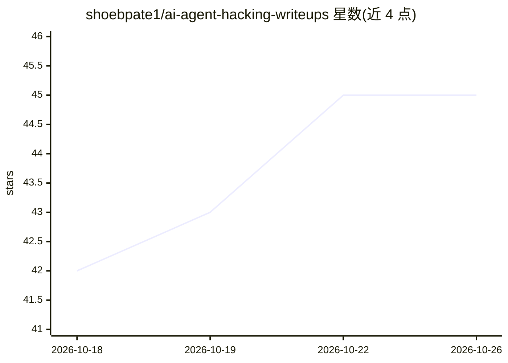

# shoebpate1/ai-agent-hacking-writeups

⭐ 45 · CC0-1.0 · 推送 2026-08-22 · [GitHub](https://github.com/shoebpate1/ai-agent-hacking-writeups) · [官网](https://research.shoebpatel.com/how-to-hack-ai-agents/) · 个人维护

**AI agent 攻击公开报告汇编（281 篇），供学习 agent 测试**

由个人维护的公开 writeup 聚合清单：收录 281 篇针对 AI agent 的攻击分析文章，按间接提示注入、提示注入/越狱/护栏绕过等类别组织，涉及数据外泄、工具滥用、供应链投毒、MCP 工具污染等攻击面。每条目含日期、受影响厂商（OpenAI、Anthropic、Microsoft、Salesforce 等）、作者与严重度/赏金信息，部分条目附 CVE 编号。定位为安全研究与 AI agent 测试的学习参考资料，附配套博客文章；内容为清单形式，无需安装运行。

## 筛选速览

| 维度 | 判定 | 备注 |
|---|---|---|
| AI 角色 | `ai-knowledge` | 知识聚合/清单类 |
| 许可风险 | `viral` | CC0-1.0 |
| 部署形态 | `desktop` | 安装包/桌面程序 |
| 模型依赖 | — | README 未给出锁定关系 |
| 硬件要求 | — | 无带数字的原话,不猜 |
| 安装摩擦 | `low` | 无编译、无系统依赖或容器化 |
| 成熟度 | — | 结构信号不足 |

## 能力要点

- 收录 281 篇 AI agent 攻击公开 writeup
- 按间接提示注入、越狱/护栏绕过等攻击类别组织
- 条目含厂商、作者、严重度与赏金信息

## 适用场景

- 学习 AI agent 安全测试的攻击案例与手法
- 研究提示注入、数据外泄、MCP 工具投毒的公开分析
- 追踪各厂商 agent 产品的已披露漏洞报告

## 场景标签

`网络安全` `精选清单` · 领域:学习与行业

## 证据(README 行号)

> L3: A collection of public writeups on attacks against AI agents: prompt injection, tool abuse, memory poisoning, and da
> L7: **281 writeups** at the moment.

## 星数曲线

2026-10-18 42 → 2026-10-26 45（+3）

---
*卡片 v1 · prompt 1.4 · 生成 2026-10-25 · 置信度 high · 依据 README sha `46cfe4c14e42` · [字段定义](../../DATASET.md)*
