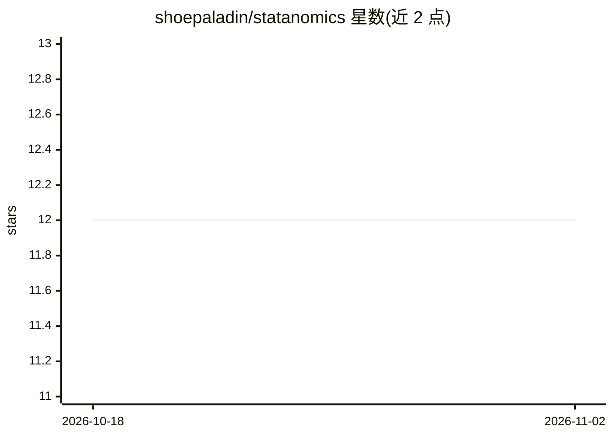

# shoepaladin/statanomics

⭐ 12 · Jupyter Notebook · 推送 2026-07-31 · [GitHub](https://github.com/shoepaladin/statanomics) · 个人维护

**因果推断模型统一语法库：估计处理效应并诊断假设**

提供平均处理效应（ATE/ATET）、异质处理效应（HTE）估计与因果诊断三类功能的 Python 库：ATE 部分支持 OLS、双重稳健、逆倾向加权等基于倾向得分的模型；HTE 部分提供截面数据方法；诊断部分提供评估非混杂与重叠假设的指标和检验（SUTVA 除外）。API 与语法集中统一，用户更换模型只需修改函数调用。通过 pip 从 GitHub 安装，另有基于双重机器学习的异质残差实现（Semenova 等 2021）。

## 筛选速览

| 维度 | 判定 | 备注 |
|---|---|---|
| AI 角色 | `ai-native` | 本体是模型或模型工具 |
| 许可风险 | `none` | — |
| 部署形态 | `library` | 以包/库形式分发 |
| 模型依赖 | — | README 未给出锁定关系 |
| 硬件要求 | — | 无带数字的原话,不猜 |
| 安装摩擦 | `low` | 无编译、无系统依赖或容器化 |
| 成熟度 | — | 结构信号不足 |

## 能力要点

- 统一 API：更换因果模型仅需修改函数调用
- ATE/ATTE 与 HTE 两类处理效应估计模型
- 无真值标签下诊断非混杂与重叠假设的检验
- 双重机器学习异质残差实现（Semenova 等 2021）

## 适用场景

- 我需要在不同因果推断模型间快速切换对比估计结果
- 我缺地面真值，想检验因果估计所依赖的假设
- 估计异质处理效应（哪些子群体处理效应不同）

## 场景标签

 · 领域:因果推断/计量经济学

## 证据(README 行号)

> L4: 1. causal inference models to estimate average treatment effects (ATE/ATET);
> L5: 2. causal inference models to estimate Heterogeneous Treatment Effects (HTE);
> L6: 3. diagnostics for assess underlying assumptions needed for causal inference following the Neyman-Rubin's Potential 

## 星数曲线

2026-10-18 12 → 2026-11-02 12（+0）

---
*卡片 v1 · prompt 1.4 · 生成 2026-11-01 · 置信度 high · 依据 README sha `8d734b4d850a` · [字段定义](../../DATASET.md)*
