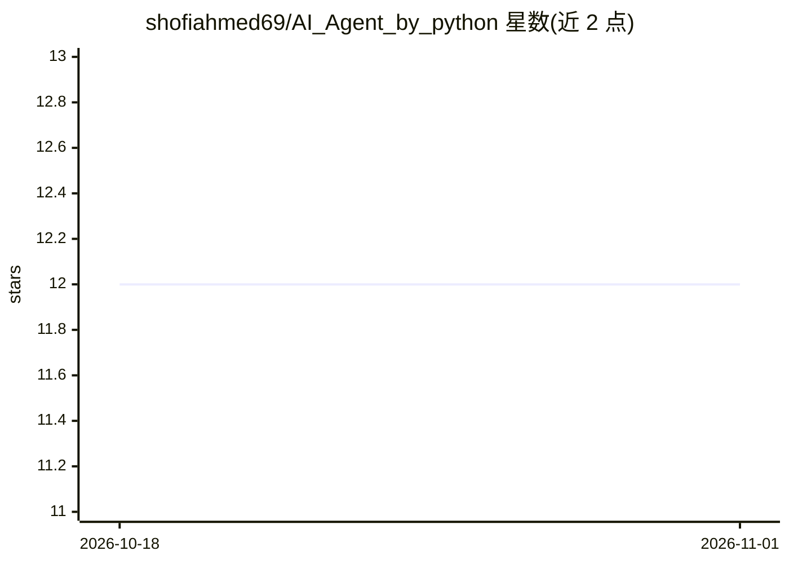

# shofiahmed69/AI_Agent_by_python

⭐ 12 · Python · 推送 2026-01-15 · [GitHub](https://github.com/shofiahmed69/AI_Agent_by_python) · 个人维护

**面向普通用户的语音风格问答聊天应用（Groq API）**

基于 Python 与 Streamlit 构建的对话式 AI 应用，通过 Groq API 调用 LLM 回答关于人物、组织、软件与天气的提问，在聊天界面中展示结果，并设计了语音风格交互逻辑。用户在侧边栏输入 Groq API Key 即可运行。实际语音输入（STT）、语音输出（TTS）与实时天气 API 属于未来改进项，当前未实现。项目声明为教育与学习用途，通过 git clone 源码安装并以 streamlit run 启动。

## 筛选速览

| 维度 | 判定 | 备注 |
|---|---|---|
| AI 角色 | `ai-native` | 本体是模型或模型工具 |
| 许可风险 | `none` | — |
| 部署形态 | `library` | 以包/库形式分发 |
| 模型依赖 | locked-api |  |
| 硬件要求 | — | 无带数字的原话,不猜 |
| 安装摩擦 | `low` | 无编译、无系统依赖或容器化 |
| 成熟度 | — | 结构信号不足 |

## 能力要点

- Groq API 驱动的问答，覆盖人物/组织/软件/天气话题
- Streamlit 聊天界面与语音风格交互逻辑
- API Key 经侧边栏输入，无需写入代码

## 适用场景

- 通过聊天界面查询人物、组织与软件的常识信息
- 以语音风格对话方式向 AI 提问
- 学习 Streamlit 与 Groq API 的集成方式

## 场景标签

 · 领域:对话式 AI 应用

## 证据(README 行号)

> L3: A simple **Voice AI Agent** built using **Python** and **Streamlit**, powered by the **Groq API**. This application 
> L83: 2. Streamlit sends the query to the **Groq API**

## 星数曲线

2026-10-18 12 → 2026-11-01 12（+0）

---
*卡片 v1 · prompt 1.4 · 生成 2026-11-01 · 置信度 mid · 依据 README sha `558ad518425b` · [字段定义](../../DATASET.md)*
