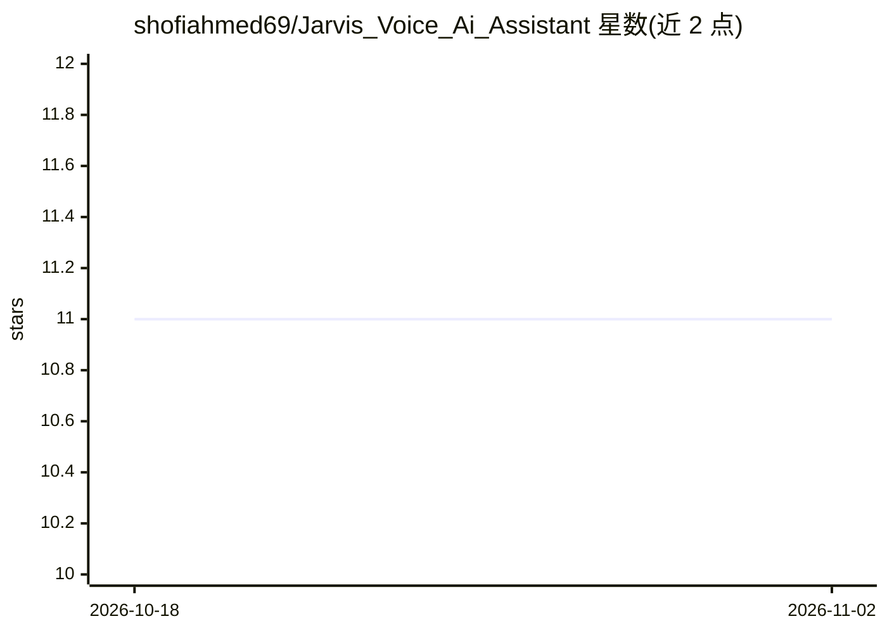

# shofiahmed69/Jarvis_Voice_Ai_Assistant

⭐ 11 · Python · 推送 2026-01-08 · [GitHub](https://github.com/shofiahmed69/Jarvis_Voice_Ai_Assistant) · 个人维护

**基于 ElevenLabs 的语音助手：用语音生成图像、网站并搜索**

Python 编写的语音驱动 AI 助手，通过 ElevenLabs Conversational AI 实现实时低延迟语音对话，用户以口头指令完成动作：调用 Stability AI（SDXL 1.0）生成图像、根据口述自动生成并保存 HTML 文件、用 DuckDuckGo 检索实时信息、保存笔记到 .txt 文件。编排层使用 Python 与 LangChain Community，音频接口依赖 PyAudio 与 ElevenLabs SDK。需 Python 3.9+ 与麦克风，克隆仓库后 pip 安装依赖运行。

## 筛选速览

| 维度 | 判定 | 备注 |
|---|---|---|
| AI 角色 | `ai-native` | 本体是模型或模型工具 |
| 许可风险 | `none` | — |
| 部署形态 | `library` | 以包/库形式分发 |
| 模型依赖 | — | README 未给出锁定关系 |
| 硬件要求 | — | 无带数字的原话,不猜 |
| 安装摩擦 | `low` | 无编译、无系统依赖或容器化 |
| 成熟度 | — | 结构信号不足 |

## 能力要点

- ElevenLabs Conversational AI 实时语音对话
- Stability AI (SDXL 1.0) 图像生成
- 口述描述自动生成并保存 HTML 文件
- DuckDuckGo 实时网络搜索与 .txt 笔记保存

## 适用场景

- 用语音指令生成图像
- 口述需求让助手生成网站 HTML
- 语音提问获取实时网络信息

## 场景标签

`语音 Agent` `图像生成` `代码生成` · 领域:编码与开发

## 证据(README 行号)

> L3: A sophisticated, voice-driven AI assistant built with Python that leverages **ElevenLabs Conversational AI** for nat
> L18: |**Voice Engine**|[cite_start]ElevenLabs Conversational AI [cite: 1, 2]|

## 星数曲线

2026-10-18 11 → 2026-11-02 11（+0）

---
*卡片 v1 · prompt 1.4 · 生成 2026-11-01 · 置信度 mid · 依据 README sha `cfe88252c78b` · [字段定义](../../DATASET.md)*
