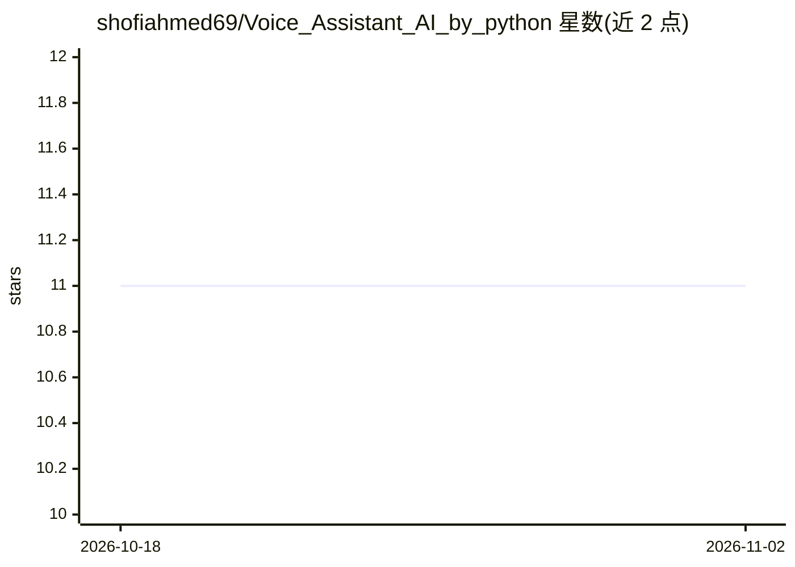

# shofiahmed69/Voice_Assistant_AI_by_python

⭐ 11 · Python · 推送 2026-01-11 · [GitHub](https://github.com/shofiahmed69/Voice_Assistant_AI_by_python) · 个人维护

**Python 语音助手：Groq 驱动对话并支持语音控制应用与搜索**

用 Python 编写的语音助手，面向终端用户：通过麦克风语音输入（SpeechRecognition）、pyttsx3 文字转语音输出，对话由 Groq 的 Llama 3.3 70B 模型生成，并按查询类型路由到 Wikipedia、OpenWeatherMap、YouTube 与 Google 搜索。支持语音启动应用、保留最近 10 轮对话上下文，默认城市为 Dhaka。运行需配置 GROQ_API_KEY 与 WEATHER_API_KEY 两个 API key，从源码安装并以 python ai_assistant.py 启动，需麦克风与网络连接。

## 筛选速览

| 维度 | 判定 | 备注 |
|---|---|---|
| AI 角色 | `ai-native` | 本体是模型或模型工具 |
| 许可风险 | `none` | — |
| 部署形态 | `library` | 以包/库形式分发 |
| 模型依赖 | locked-api |  |
| 硬件要求 | — | 无带数字的原话,不猜 |
| 安装摩擦 | `low` | 无编译、无系统依赖或容器化 |
| 成熟度 | — | 结构信号不足 |

## 能力要点

- Groq Llama 3.3 70B 模型生成对话回复
- 语音识别与文字转语音交互，支持免手动控制
- 按查询类型路由到 Wikipedia/天气 API/YouTube/Google 搜索
- 保留最近 10 轮对话上下文

## 适用场景

- 用语音查询天气、时间与百科信息
- 通过语音播放 YouTube 视频和打开应用
- 进行连续的语音 AI 对话问答

## 场景标签

`AI 助手` `语音 Agent` · 领域:对话与助手

## 证据(README 行号)

> L11: - 🤖 **AI-Powered Conversations**: Natural language understanding using Groq's Llama 3.3 70B model
> L12: - 🎤 **Voice Recognition**: Hands-free control with speech-to-text
> L13: - 🔊 **Text-to-Speech**: Natural voice responses

## 星数曲线

2026-10-18 11 → 2026-11-02 11（+0）

---
*卡片 v1 · prompt 1.4 · 生成 2026-11-01 · 置信度 mid · 依据 README sha `0cb98df8c204` · [字段定义](../../DATASET.md)*
