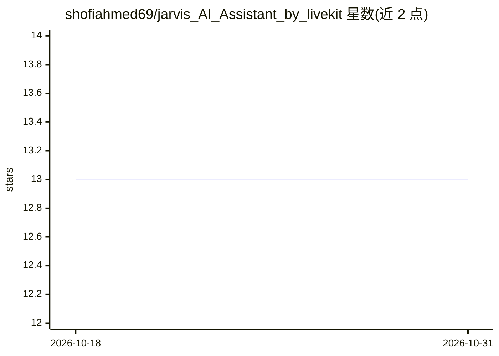

# shofiahmed69/jarvis_AI_Assistant_by_livekit

⭐ 13 · Python · 推送 2026-02-08 · [GitHub](https://github.com/shofiahmed69/jarvis_AI_Assistant_by_livekit) · 个人维护

**基于 LiveKit 的实时语音助手：天气查询与网络搜索**

用 Python 与 LiveKit Agents 构建的实时语音助手，面向个人用户：支持自然语言对话、通过 Open-Meteo API 查询天气（限定孟加拉国城市）、经 DuckDuckGo 搜索网络并以语音低延迟响应。可在终端或 LiveKit Playground 两种方式运行。需 Python 3.10+、LiveKit 账号与 OpenAI API key，通过 git clone 源码加 pip 安装依赖部署。邮件、日历、智能家居等功能列于 Roadmap 尚未实现。

## 筛选速览

| 维度 | 判定 | 备注 |
|---|---|---|
| AI 角色 | `ai-native` | 本体是模型或模型工具 |
| 许可风险 | `none` | — |
| 部署形态 | `library` | 以包/库形式分发 |
| 模型依赖 | — | README 未给出锁定关系 |
| 硬件要求 | — | 无带数字的原话,不猜 |
| 安装摩擦 | `low` | 无编译、无系统依赖或容器化 |
| 成熟度 | — | 结构信号不足 |

## 能力要点

- 实时语音交互，文档称响应低于 2 秒
- function_tool 形式的天气查询与 DuckDuckGo 网络搜索工具
- 终端与 LiveKit Playground 双部署方式
- 天气数据来自 Open-Meteo API，搜索经 LangChain 集成

## 适用场景

- 语音询问指定城市的实时天气
- 用自然语言进行语音网络搜索
- 在 LiveKit Playground 中进行低延迟语音对话

## 场景标签

`语音 Agent` · 领域:对话与助手

## 证据(README 行号)

> L7: JARVIS is a real-time voice assistant built with Python and LiveKit that can check weather, search the web, and resp
> L13: - 🎙️ **Voice Interaction** - Natural conversation with low-latency responses

## 星数曲线

2026-10-18 13 → 2026-10-31 13（+0）

---
*卡片 v1 · prompt 1.4 · 生成 2026-10-31 · 置信度 mid · 依据 README sha `515a16e68101` · [字段定义](../../DATASET.md)*
