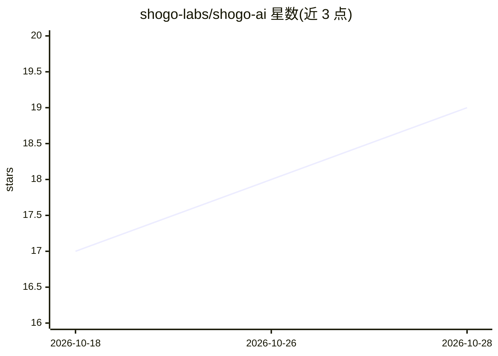

# shogo-labs/shogo-ai

⭐ 19 · TypeScript · AGPL-3.0 · 推送 2026-10-27 · [GitHub](https://github.com/shogo-labs/shogo-ai) · [官网](https://shogo.ai) · 组织维护

**构建与运行 AI agent 的开源 TypeScript 平台，可自托管**

面向开发者的 agentic 产品平台：TypeScript monorepo，整合 Hono API、Expo 客户端（Web/iOS/Android/桌面）、agent 运行时、项目运行时与开发者 SDK，支持构建能读取系统数据、执行操作、运行端到端工作流的 AI agent。采用拆分许可：@shogo-ai/* 库与客户端为 MIT，服务器组件为 AGPL-3.0-or-later，托管版 Shogo Cloud 为专有。本地运行需克隆仓库、Bun 安装、Docker 启动 Postgres/Redis/MinIO 并执行迁移，无一条命令快速启动；也可自托管或使用云服务。

## 筛选速览

| 维度 | 判定 | 备注 |
|---|---|---|
| AI 角色 | `ai-ecosystem` | LLM/agent 周边工具 |
| 许可风险 | `viral` | AGPL-3.0 |
| 部署形态 | `None` |  |
| 模型依赖 | — | README 未给出锁定关系 |
| 硬件要求 | — | 无带数字的原话,不猜 |
| 安装摩擦 | `low` | 无编译、无系统依赖或容器化 |
| 成熟度 | `idea` | |

## 能力要点

- Hono API + Expo 客户端 + agent 运行时 + SDK 的 monorepo 平台
- SDK 与客户端库 MIT，服务器组件 AGPL-3.0，拆分许可模式
- 发布 7 个 @shogo-ai/* npm 包（SDK/core/agent/db/email/voice/cli）
- 支持自托管与本地桌面/离线使用

## 适用场景

- 构建能操作自有系统、执行工作流的 AI agent 产品
- 自托管 agent 平台并连接 970+ 应用集成
- 基于 SDK 与移动/桌面客户端交付 agentic 应用

## 场景标签

`Agent 框架` `工作流自动化` · 领域:Agent 开发

## 证据(README 行号)

> L3: Shogo is an open-source platform for building AI agents that do real work:
> L9: Shogo combines a Hono API, Expo-based clients, agent runtimes, project
> L10: runtimes, and a developer SDK into one platform for building and operating

## 星数曲线

2026-10-18 17 → 2026-10-28 19（+2）

---
*卡片 v1 · prompt 1.4 · 生成 2026-10-28 · 置信度 high · 依据 README sha `215ba7013014` · [字段定义](../../DATASET.md)*
