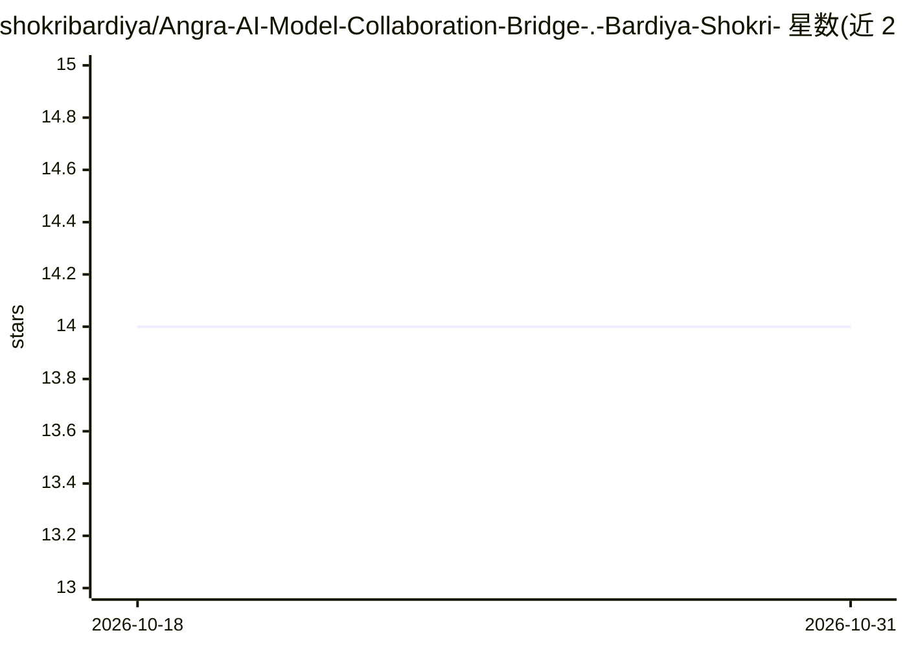

# shokribardiya/Angra-AI-Model-Collaboration-Bridge-.-Bardiya-Shokri-

⭐ 14 · BSL-1.0 · 推送 2026-10-26 · [GitHub](https://github.com/shokribardiya/Angra-AI-Model-Collaboration-Bridge-.-Bardiya-Shokri-) · [官网](https://shokribardiya.github.io/Angra_AI/) · 个人维护

**协调本地模型互通的观测与咨询桥接工具（LM Studio/Bionic）**

单文件 Python 工具，置于用户与本地模型运行时之间：实时观测 LM Studio 模型生命周期与生成指标（tokens、延迟、TTFT、tokens/秒），并在 LM Studio 与 Bionic 中建立主/辅助模型间的显式会话级链接，让主模型通过 angra_consult_model 工具向辅助模型提出单一子问题，中继结构化上下文（身份/任务/约束/结果分离）。不做推理、不加载/路由模型，推理全部由 LM Studio 完成。链接默认无授权，经 11 道守卫（fail closed）与安全上限（上下文/输出 token、超时、并发）约束，连接图为扁平一层、无环。安装与启动器仅支持 Windows，Python 3.8+，标准库零依赖，无需 pip。

## 筛选速览

| 维度 | 判定 | 备注 |
|---|---|---|
| AI 角色 | `ai-ecosystem` | LLM/agent 周边工具 |
| 许可风险 | `permissive` | BSL-1.0 |
| 部署形态 | `library` | 以包/库形式分发 |
| 模型依赖 | — | README 未给出锁定关系 |
| 硬件要求 | — | 无带数字的原话,不猜 |
| 安装摩擦 | `low` | 无编译、无系统依赖或容器化 |
| 成熟度 | `idea` | |

## 能力要点

- LM Studio 模型生命周期与生成指标（tokens/延迟/TTFT/tokens每秒）实时观测
- 主模型经权限控制向辅助模型发起单问题咨询（4 个工具，11 道守卫 fail closed）
- 会话级权限（off/once/session/enabled）与安全上限（上下文、输出、超时、并发均钳制）
- Python 标准库零依赖，install/uninstall 可逆，本地优先

## 适用场景

- 观测多个本地模型在 LM Studio 中的运行与生成指标
- 让较弱的本地主模型把小范围子问题委托给更强的辅助模型
- 以显式权限与审计记录控制模型间互通，而非复制粘贴对话

## 场景标签

`LLM 可观测性` `多智能体` · 领域:Agent 开发

## 证据(README 行号)

> L28: ANGRA is a single-file Python tool that sits **between** your local model
> L138: ANGRA does not run inference. It watches the runtime you already use,
> L198: Angra never loads, downloads, unloads, switches or routes models. It never performs inference and never starts a s

## 星数曲线

2026-10-18 14 → 2026-10-31 14（+0）

---
*卡片 v1 · prompt 1.4 · 生成 2026-10-31 · 置信度 mid · 依据 README sha `d239b8380b68` · [字段定义](../../DATASET.md)*
