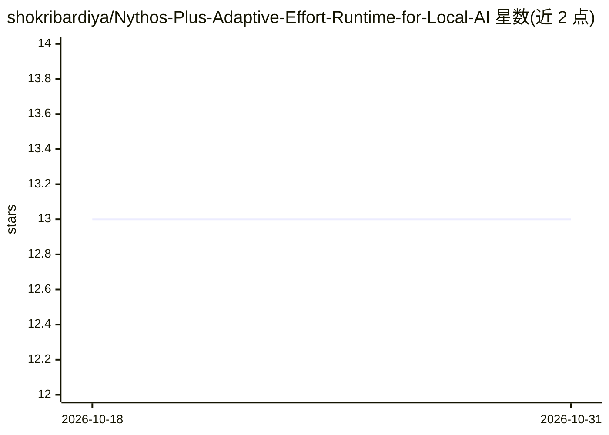

# shokribardiya/Nythos-Plus-Adaptive-Effort-Runtime-for-Local-AI

⭐ 13 · Python · BSL-1.0 · 推送 2026-10-07 · [GitHub](https://github.com/shokribardiya/Nythos-Plus-Adaptive-Effort-Runtime-for-Local-AI) · [官网](https://shokribardiya.github.io/Oblivions0.github.io/) · 个人维护 · 中文 README

**本地 AI 的自适应推理力度运行时：按任务决定最小足够计算量**

单文件、仅用 Python 标准库的运行时，围绕"推理力度是资源"设计：对每个请求估计 E0-E4 五档力度中哪一档的效用（质量-成本-风险）足以覆盖任务，配合 LM Studio 本地 REST API 执行，并用 SQLite 记录学习到的每模型响应曲线、滞后切换与预算/资源上限。提供 CLI、MCP 服务器（JSON-RPC over stdio）与 LM Studio 插件安装器。限制：不加载/切换模型、不存储提示词或输出、模拟基线数据（mock LM Studio server）非真实模型测量；需 Python 3.9+ 与开启本地服务器的 LM Studio。

## 筛选速览

| 维度 | 判定 | 备注 |
|---|---|---|
| AI 角色 | `ai-ecosystem` | LLM/agent 周边工具 |
| 许可风险 | `permissive` | BSL-1.0 |
| 部署形态 | `library` | 以包/库形式分发 |
| 模型依赖 | — | README 未给出锁定关系 |
| 硬件要求 | — | 无带数字的原话,不猜 |
| 安装摩擦 | `low` | 无编译、无系统依赖或容器化 |
| 成熟度 | — | 结构信号不足 |

## 能力要点

- E0-E4 五档力度阶梯与效用型策略（quality - lam*cost - risk）
- SQLite 持久化学习曲线（COLD→CALIBRATED→LEARNED）与冷启动先验
- 仅回环网络、shell=False、预算硬上限等安全约束并有自检覆盖
- 单文件、仅标准库，约 3700 行，无需 pip 安装第三方包

## 适用场景

- 在 LM Studio 本地部署中按任务难度动态控制推理计算量
- 通过 MCP 服务器向 agent 提供 effort 建议与评估工具
- 对比 RAW、PULSE 与固定力度模式的基准表现

## 场景标签

`推理引擎` · 领域:训练与推理

## 证据(README 行号)

> L7: **Adaptive Effort Runtime for local AI systems**
> L128: |`LMStudioBridge`|Streaming client for the official local REST API (`/api/v0/models`, `/v1/chat/completions`); mea
> L137: |`MCPServer`|JSON-RPC over stdio: advice and evaluation tools only (no inference)|

## 星数曲线

2026-10-18 13 → 2026-10-31 13（+0）

---
*卡片 v1 · prompt 1.4 · 生成 2026-10-31 · 置信度 mid · 依据 README sha `f1c17cb51f5e` · [字段定义](../../DATASET.md)*
