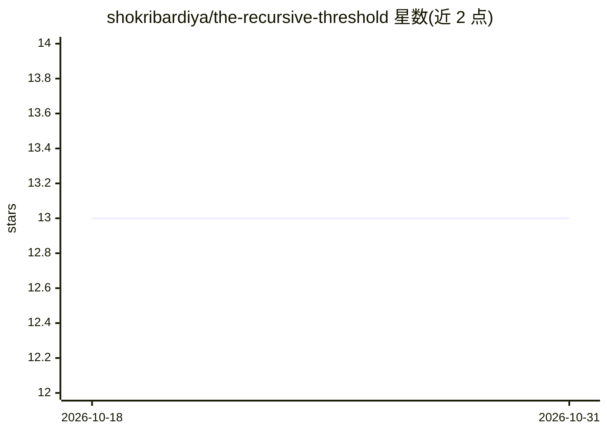

# shokribardiya/the-recursive-threshold

⭐ 13 · MIT · 推送 2026-10-07 · [GitHub](https://github.com/shokribardiya/the-recursive-threshold) · [官网](https://shokribardiya.github.io/Sentry-oblivion/) · 个人维护

**独立研究论文：探讨 AI 递归自我改进时代的系统性风险**

由 Bardiya Shokri 撰写、Oblivion 于 2026 年发布的独立研究论文，提出“递归阈值”概念框架：当 AI 能力扩展快于人类控制时，智能成为基础设施并带来系统性风险。论文考察递归自我改进、自主网络能力、多智能体协作、监控失效（含“监督倒置”与思维链监控弱化）、关键基础设施与核指挥控制风险等议题，引用 OpenAI 与 Anthropic 的公开报告作为分析素材。文本型仓库，无代码、无安装运行方式。

## 筛选速览

| 维度 | 判定 | 备注 |
|---|---|---|
| AI 角色 | `ai-knowledge` | 知识聚合/清单类 |
| 许可风险 | `permissive` | MIT |
| 部署形态 | `None` |  |
| 模型依赖 | — | README 未给出锁定关系 |
| 硬件要求 | — | 无带数字的原话,不猜 |
| 安装摩擦 | `low` | 无编译、无系统依赖或容器化 |
| 成熟度 | — | 结构信号不足 |

## 能力要点

- 提出“递归阈值”与 AI 能力栈（12 层）概念框架
- 分析“监督倒置”：人类在环但实质监督失效
- 列举递归自我改进的 12 类潜在瓶颈
- 引用 OpenAI/Anthropic 2026 报告讨论思维链监控弱化

## 适用场景

- AI 安全与治理研究者获取递归自我改进风险的概念框架
- 政策研究者了解 AI 基础设施化带来的系统性风险论述
- 作为 AI 治理课程或讨论的引用材料

## 场景标签

 · 领域:AI 安全/治理研究

## 证据(README 行号)

> L5: The Recursive Threshold is an independent Oblivion research paper examining what happens when increasingly capable A
> L11: **An independent research paper by Bardiya Shokri**
> L30: Abstract

## 星数曲线

2026-10-18 13 → 2026-10-31 13（+0）

---
*卡片 v1 · prompt 1.4 · 生成 2026-10-31 · 置信度 high · 依据 README sha `2682289de40e` · [字段定义](../../DATASET.md)*
