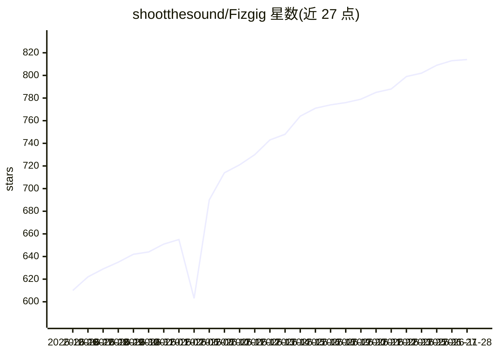

# shootthesound/Fizgig

⭐ 814 · Python · Apache-2.0 · 推送 2026-11-27 · [GitHub](https://github.com/shootthesound/Fizgig) · 个人维护

**消费级 GPU 上的 LoRA 训练与微调工作台**

Fizgig 是一个 LoRA 与模型微调工作室，面向消费级显卡（最低 8 GB 显存）训练、微调、修复与提取多个图像、视频、音乐与语音基础模型的 LoRA/LoKR。功能覆盖数据准备、自动/手动打标（含 JoyCaption 与 WD EVA02 tagger）、训练队列、样本预览、epoch 对比（LoRA Royale）、LoRA 修复与隔离、Studio 渲染工作台。可本地安装（Windows/Linux，含 AMD 支持），也可一键部署到 RunPod 租用 GPU。版本日志详尽，附视频教程。

## 筛选速览

| 维度 | 判定 | 备注 |
|---|---|---|
| AI 角色 | `ai-ecosystem` | LLM/agent 周边工具 |
| 许可风险 | `permissive` | Apache-2.0 |
| 部署形态 | `None` |  |
| 模型依赖 | — | README 未给出锁定关系 |
| 硬件要求 | — | 无带数字的原话,不猜 |
| 安装摩擦 | `medium` | 含编译或系统依赖之一 |
| 成熟度 | — | 结构信号不足 |

## 能力要点

- 支持十余个基础模型的 LoRA/LoKR 训练与修复，最低 8 GB 显存
- 自动打标、AI 重打标、loss watch 与查重等数据集工具
- Studio 渲染工作台：LoRA 热力图、队列、参考强度与 blend 实验
- AMD 显卡支持与 RunPod 一键部署

## 适用场景

- 在消费级 GPU 上为自己的人物/风格训练 LoRA
- 修复表现异常的已有 LoRA 而无需重新训练
- 对比不同 epoch 的样本挑选最佳 LoRA
- 租用云端 GPU 时零安装地运行训练流程

## 场景标签

`微调` `图像生成` · 领域:内容生成

## 证据(README 行号)

> L3:  Fine-tune base models on consumer GPUs — down to 8 GB. Fix broken LoRAs without retraining. Find the best epoch by 
> L4:  A train · fine-tune · repair · explore workbench built end-to-end for Flux 2 Klein 9B , Flux 3 Image Klein , Fibo 2

## 星数曲线

2026-10-26 610 → 2026-11-28 814（+204）

---
*卡片 v1 · prompt 1.4 · 生成 2026-11-28 · 置信度 high · 依据 README sha `74949ee96ced` · [字段定义](../../DATASET.md)*
