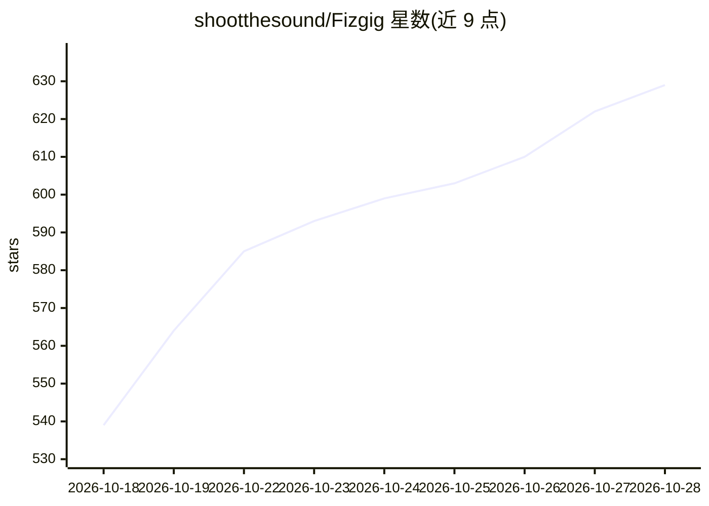

# shootthesound/Fizgig

⭐ 635 · Python · Apache-2.0 · 推送 2026-10-28 · [GitHub](https://github.com/shootthesound/Fizgig) · 个人维护

**消费级 GPU 上训练图像/视频/音乐模型 LoRA 与微调的训练工作台**

面向图像、视频与音乐生成模型的 LoRA/LoKR 训练与全量微调工具：支持 Klein 9B、Flux 3 Image Klein、Krea 2、MiniMax H3、Qwen Image 2.1、MOSS-Image、Z-Image Turbo、SDXL、Anima 与 ACE-Step 1.5 XL 共 10 类模型，最低 8 GB 显存可训练。训练之外提供工作台：逐块修复 LoRA 不需重训、按 epoch 渲染对比、分块剖析与降秩提取。以自带窗口/浏览器 Web UI 形式运行，可连接局域网其他电脑 GPU 与 RunPod 租用算力；显存规划（精度、块交换）自动适配空闲显存。兼容加载 kohya、PEFT、OneTrainer、AI-Toolkit 与 LyCORIS 格式 LoRA，输出 .safetensors 可直接用于 ComfyUI。

## 筛选速览

| 维度 | 判定 | 备注 |
|---|---|---|
| AI 角色 | `ai-ecosystem` | LLM/agent 周边工具 |
| 许可风险 | `permissive` | Apache-2.0 |
| 部署形态 | `None` |  |
| 模型依赖 | — | README 未给出锁定关系 |
| 硬件要求 | — | 无带数字的原话,不猜 |
| 安装摩擦 | `low` | 无编译、无系统依赖或容器化 |
| 成熟度 | — | 结构信号不足 |

## 能力要点

- 10 类图像/视频/音乐模型的 LoRA、LoKR、slider/edit LoRA 与全量微调，最低 8 GB 显存
- 工作台四件套：Studio 逐块修复与混合、LoRA Royale epoch 对比、Profiler 分块剖析、Extract 降秩提取
- Fizgig LoRA Isolation：多人训练入一个 LoRA 时互不串脸（50 个陌生人测试 0 串脸）
- 自动显存规划（精度/块交换/预览自适应），支持局域网 Pods 与 RunPod 租用 GPU

## 适用场景

- 用自己的照片训练特定人物的 LoRA 并保持他人面部不变
- 在不重训的前提下逐块调整、修复已下载的 LoRA
- 按同一 seed 渲染各 epoch 对比，挑选最佳训练轮次
- 在租用 GPU 或家中多台电脑上排队跑训练任务

## 场景标签

`微调` · 领域:训练与推理

## 证据(README 行号)

> L39: A trainer and workbench for image, video and music models, in its own window on your computer, in your browser, or 
> L47: Memory plans itself: precision, block swap and previews size to your free VRAM, and if a preview can't fit, trainin

## 星数曲线

2026-10-18 539 → 2026-10-28 629（+90）

---
*卡片 v1 · prompt 1.4 · 生成 2026-10-21 · 置信度 high · 依据 README sha `bf1432537e31` · [字段定义](../../DATASET.md)*
