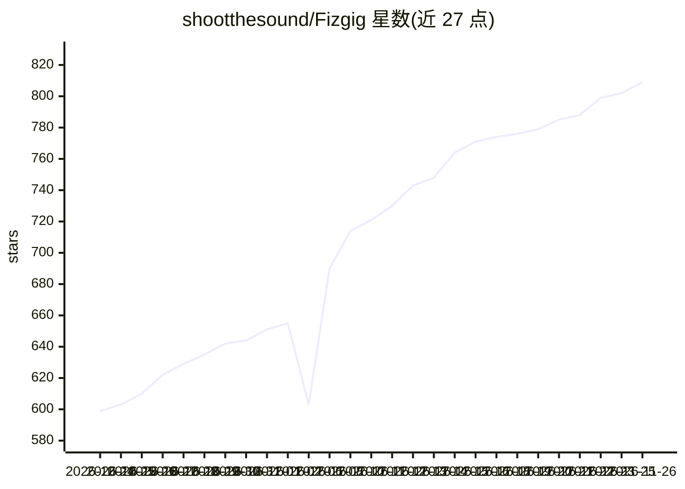

# shootthesound/Fizgig

⭐ 809 · Python · Apache-2.0 · 推送 2026-11-25 · [GitHub](https://github.com/shootthesound/Fizgig) · 个人维护

**面向消费级 GPU 的 LoRA/微调训练工作室**

针对 Klein 9B、Krea 2、MiniMax H3、Qwen Image 2.1、Z-Image Turbo、SDXL、Anima、ACE-Step 等图像/视频/音乐模型的训练与微调工作台：支持训练与提取 LoRA、LoKR、编辑 LoRA 与 slider LoRA，提供坏 LoRA 修复、按 epoch 浏览预览选优、训练热力图、AI 打标（JoyCaption、WD EVA02）、队列渲染 Studio。覆盖 8 GB 起的消费级 GPU 与 AMD 显卡，可在本机安装或部署到 RunPod 租赁硬件。版本新闻以 changelog 形式列出。

## 筛选速览

| 维度 | 判定 | 备注 |
|---|---|---|
| AI 角色 | `ai-ecosystem` | LLM/agent 周边工具 |
| 许可风险 | `permissive` | Apache-2.0 |
| 部署形态 | `None` |  |
| 模型依赖 | — | README 未给出锁定关系 |
| 硬件要求 | — | 无带数字的原话,不猜 |
| 安装摩擦 | `medium` | 含编译或系统依赖之一 |
| 成熟度 | — | 结构信号不足 |

## 能力要点

- 支持图像/视频/音乐多类模型的 LoRA 与 LoKR 训练、修复与提取
- 官方部署入口支持 RunPod 租赁硬件一键运行，无需本机安装
- 训练热力图与 trigger-word attention map 可视化学习效果
- 支持 NVIDIA 与 AMD 显卡，低至 8 GB VRAM

## 适用场景

- 在消费级显卡上用自己的照片/视频/声音训练 LoRA
- 修复训练效果不佳的已有 LoRA 而不重训
- 在 RunPod 租赁的 GPU 上运行完整训练流程

## 场景标签

`微调` · 领域:训练与推理

## 证据(README 行号)

> L3:  Fine-tune base models on consumer GPUs — down to 8 GB. Fix broken LoRAs without retraining. Find the best epoch by 
> L4:  A train · fine-tune · repair · explore workbench built end-to-end for Flux 2 Klein 9B , Flux 3 Image Klein , Fibo 2

## 星数曲线

2026-10-24 599 → 2026-11-26 809（+210）

---
*卡片 v1 · prompt 1.4 · 生成 2026-11-26 · 置信度 mid · 依据 README sha `2932774e1af9` · [字段定义](../../DATASET.md)*
