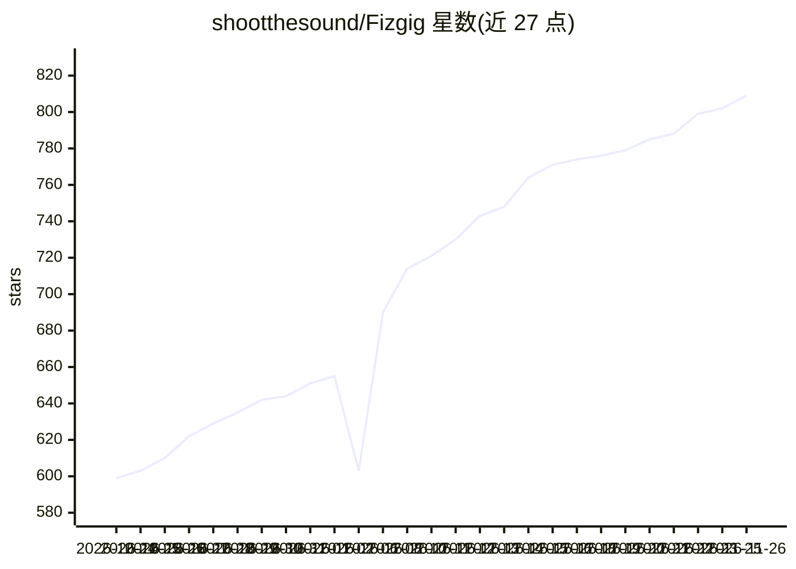

# shootthesound/Fizgig

⭐ 809 · Python · Apache-2.0 · 推送 2026-11-25 · [GitHub](https://github.com/shootthesound/Fizgig) · 个人维护

**消费级 GPU 上的 LoRA 训练与微调工作台**

面向图像、视频与音乐生成模型的 LoRA/LoKR 训练工作台，覆盖 Klein 9B、Krea 2、MiniMax H3 系列等十余个基础模型，宣称可在低至 8 GB 显存的消费级 GPU 上运行。功能包括训练与全量微调、无需重训的 LoRA 修复、按 epoch 预览挑选、AI 自动打标（JoyCaption、WD EVA02）、训练热力图可视化、Studio 渲染工作台与任务队列。支持 AMD 显卡与 RunPod 租赁硬件部署，提供 Windows 安装器与 Linux 安装脚本。

## 筛选速览

| 维度 | 判定 | 备注 |
|---|---|---|
| AI 角色 | `ai-ecosystem` | LLM/agent 周边工具 |
| 许可风险 | `permissive` | Apache-2.0 |
| 部署形态 | `None` |  |
| 模型依赖 | — | README 未给出锁定关系 |
| 硬件要求 | — | 无带数字的原话,不猜 |
| 安装摩擦 | `medium` | 含编译或系统依赖之一 |
| 成熟度 | — | 结构信号不足 |

## 能力要点

- 训练 LoRA/LoKR 与全量微调，最低支持 8 GB 显存显卡
- LoRA 修复与隔离（LoRA Isolation）、Muon 优化器、Automagic 自动学习率
- JoyCaption 与 WD EVA02 两种 AI 打标器，自动下载
- 训练热力图与注意力地图可视化，Studio 队列渲染

## 适用场景

- 在消费级显卡上用自己的照片训练人物 LoRA
- 修复效果不佳的已有 LoRA 而不重新训练
- 给动画/插画模型批量生成 booru 标签训练数据
- 租用 RunPod GPU 免本地安装直接训练

## 场景标签

`微调` · 领域:训练与推理

## 证据(README 行号)

> L3:  Fine-tune base models on consumer GPUs — down to 8 GB. Fix broken LoRAs without retraining. Find the best epoch by 
> L4:  A train · fine-tune · repair · explore workbench built end-to-end for Flux 2 Klein 9B , Flux 3 Image Klein , Fibo 2
> L51: > - **Fizgig 9.2 — faster training on PyTorch 2.15, with less memory.** A MOSS-Image LoRA at batch 1 on an RTX 5090

## 星数曲线

2026-10-24 599 → 2026-11-26 809（+210）

---
*卡片 v1 · prompt 1.4 · 生成 2026-11-25 · 置信度 high · 依据 README sha `68c6f871cccd` · [字段定义](../../DATASET.md)*
