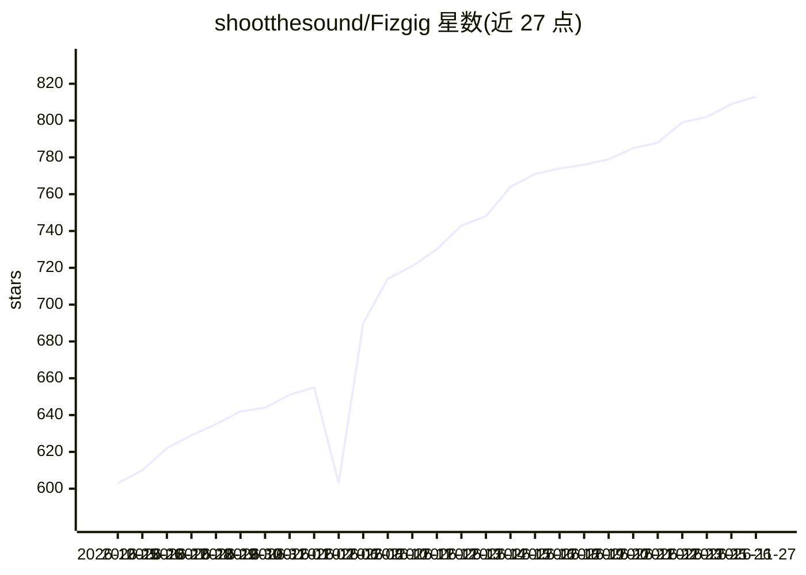

# shootthesound/Fizgig

⭐ 813 · Python · Apache-2.0 · 推送 2026-11-26 · [GitHub](https://github.com/shootthesound/Fizgig) · 个人维护

**面向消费级 GPU 的图像/视频/音乐 LoRA 训练与微调工作台**

针对 Klein 9B、Flux 3、Krea 2、MiniMax H3、Qwen Image 2.1、Z-Image、SDXL、Anima、ACE-Step 等模型的 LoRA/LoKR 训练工作室：提供数据集准备、自动与人工标注（JoyCaption、WD EVA02）、训练、LoRA 修复与隔离、epoch 预览对比（LoRA Royale）、热力图训练地图，以及独立的 Studio 渲染生成器。宣称可在 8 GB 起步的消费级 GPU 上训练，支持 NVIDIA 与 AMD 显卡，提供 RunPod 云端一键部署、Windows/Linux 安装器与视频教程。

## 筛选速览

| 维度 | 判定 | 备注 |
|---|---|---|
| AI 角色 | `ai-ecosystem` | LLM/agent 周边工具 |
| 许可风险 | `permissive` | Apache-2.0 |
| 部署形态 | `None` |  |
| 模型依赖 | — | README 未给出锁定关系 |
| 硬件要求 | — | 无带数字的原话,不猜 |
| 安装摩擦 | `medium` | 含编译或系统依赖之一 |
| 成熟度 | — | 结构信号不足 |

## 能力要点

- 支持图像、视频、音乐与声音模型的 LoRA/LoKR 训练与修复
- 训练预览热力图与 trigger-word 注意力地图逐 epoch 检视学习效果
- JoyCaption 与 WD EVA02 标注器可从设置面板下载
- 支持 RunPod 租赁 GPU 一键部署，无需本地安装

## 适用场景

- 在消费级显卡上用自己的照片训练人物或风格 LoRA
- 修复表现不佳的 LoRA 而不重新训练
- 对比不同 epoch 的预览图挑出最佳产出
- 训练视频生成与音乐生成模型的适配器

## 场景标签

`微调` `图像生成` · 领域:内容生成

## 证据(README 行号)

> L1: Fizgig — LoRA & Fine-tune Studio for Klein 9B, Flux 3 Image Klein, Fibo 2.0, Krea 2, MiniMax H3, Vimoo 1.0 Lite, Qwe
> L4:  A train · fine-tune · repair · explore workbench built end-to-end for Flux 2 Klein 9B , Flux 3 Image Klein , Fibo 2

## 星数曲线

2026-10-25 603 → 2026-11-27 813（+210）

---
*卡片 v1 · prompt 1.4 · 生成 2026-11-27 · 置信度 high · 依据 README sha `7029df2979d6` · [字段定义](../../DATASET.md)*
