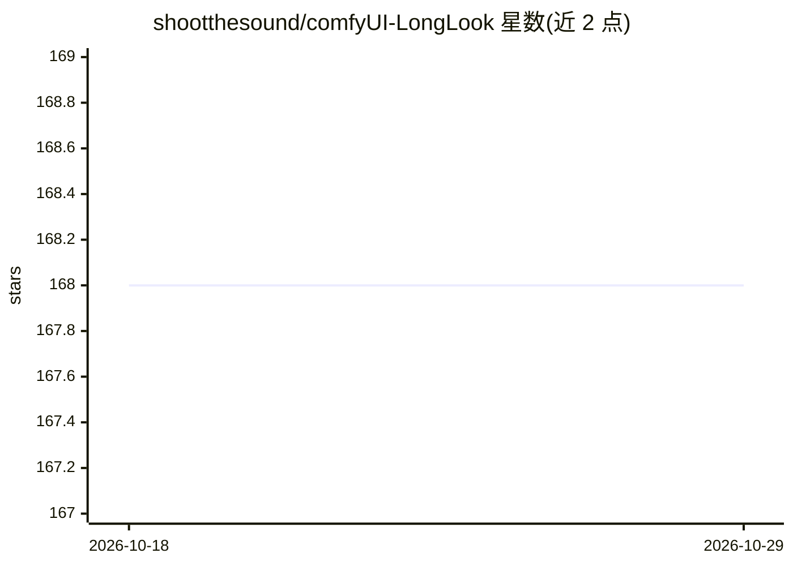

# shootthesound/comfyUI-LongLook

⭐ 168 · Python · 推送 2025-12-30 · [GitHub](https://github.com/shootthesound/comfyUI-LongLook) · 个人维护

**ComfyUI 节点包：为 Wan 2.2 视频生成提供 FreeLong 谱混合与分块续生**

面向使用 ComfyUI 与 Wan 2.2 模型的视频生成用户的节点包。基于 FreeLong（NeurIPS 2024）实现全局/局部双流注意力与 FFT 频谱混合，以改善 81 帧内的运动一致性与提示词遵循；通过末帧锚点分块链式生成实现不限长度视频。另提供运动速度控制（时间 RoPE 缩放）、更严格运动锁定的 Enforcer 变体与续生条件化节点。限制：单次生成超过 81 帧效果不稳定，分块为主要途径。安装方式为 git clone 至 custom_nodes。

## 筛选速览

| 维度 | 判定 | 备注 |
|---|---|---|
| AI 角色 | `ai-ecosystem` | LLM/agent 周边工具 |
| 许可风险 | `none` | — |
| 部署形态 | `None` |  |
| 模型依赖 | — | README 未给出锁定关系 |
| 硬件要求 | — | 无带数字的原话,不猜 |
| 安装摩擦 | `low` | 无编译、无系统依赖或容器化 |
| 成熟度 | `idea` | |

## 能力要点

- FreeLong 双流注意力 + FFT 谱混合，改善 81 帧内运动一致性
- 末帧锚点分块链式生成，不限长度且 VRAM 恒定（8GB+ 兼容）
- WanMotionScale 通过时间 RoPE 缩放调节运动速度
- WanFreeLongEnforcer 三层频率混合的实验性运动锁定节点

## 适用场景

- 在 ComfyUI 中生成运动方向稳定的 Wan 2.2 视频
- 用分块续生方式制作超过 81 帧的长视频
- 调节视频运动速度或配合 RIFE 插值延长视频

## 场景标签

`视频生成` · 领域:内容生成

## 证据(README 行号)

> L5: **Towards consistent motion and prompt adherence for Wan 2.2 video generation.**
> L93: Just add `WanFreeLong` before your sampler:

## 星数曲线

2026-10-18 168 → 2026-10-29 168（+0）

---
*卡片 v1 · prompt 1.4 · 生成 2026-10-22 · 置信度 high · 依据 README sha `b5675811b70b` · [字段定义](../../DATASET.md)*
