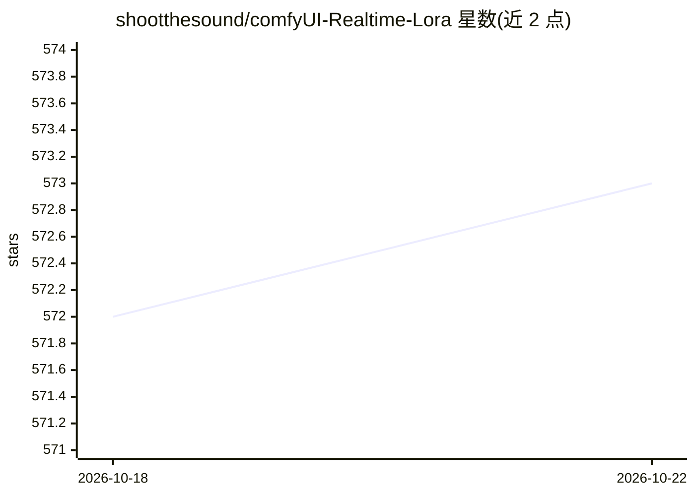

# shootthesound/comfyUI-Realtime-Lora

⭐ 573 · Python · MIT · 推送 2026-08-21 · [GitHub](https://github.com/shootthesound/comfyUI-Realtime-Lora) · 个人维护

**ComfyUI 内实时 LoRA 训练/分析/分块加载节点集**

面向 ComfyUI 用户的自定义节点集，共 33 个节点：10 个训练节点通过三个后端（Kohya sd-scripts、Musubi Tuner、AI-Toolkit）在 ComfyUI 内直接训练 LoRA，覆盖 SDXL、SD 1.5、FLUX、Z-Image、Qwen Image、Wan 2.2、FLUX Klein 等 8 种架构；另含块级分析器、按块选择性加载器（含强度调度与 40+ 预设）、模型层编辑器与工具节点。分析/加载功能开箱即用，训练需另行安装对应后端与模型文件。

## 筛选速览

| 维度 | 判定 | 备注 |
|---|---|---|
| AI 角色 | `ai-ecosystem` | LLM/agent 周边工具 |
| 许可风险 | `permissive` | MIT |
| 部署形态 | `None` |  |
| 模型依赖 | — | README 未给出锁定关系 |
| 硬件要求 | `gpu-8g` | |
| 安装摩擦 | `medium` | 含编译或系统依赖之一 |
| 成熟度 | — | 结构信号不足 |

## 能力要点

- 统一界面接入 3 个训练后端、8 种训练架构（33 节点）
- V2 合并节点：块级分析+选择性加载+强度调度+导出过滤后 LoRA
- 支持 LoKR/LoHa/GLoRA 等多种 LoRA 格式检测与处理
- 模型层编辑器可缩放基础模型各块并保存修改后模型

## 适用场景

- 在 ComfyUI 工作流内几分钟训一个快速 LoRA 并立即用于 img2img
- 训练角色/风格 LoRA 保持多代生成的一致性
- 按块开关与强度调度精细控制 LoRA 对生成的影响
- 为 Wan 2.2 视频训练首尾帧时序一致性 LoRA

## 场景标签

 · 领域:图像生成/模型训练工具

## 证据(README 行号)

> L6: **Train**, **analyze**, **selectively load by block**, and **edit base models** for **SDXL, SD 1.5, FLUX, Z-Image, Q
> L20: **8 training architectures plus Krea 2 LoRA block loading. 3 training backends. 33 nodes total. **

## 星数曲线

2026-10-18 572 → 2026-10-22 573（+1）

---
*卡片 v1 · prompt 1.4 · 生成 2026-10-21 · 置信度 high · 依据 README sha `d65cb556f087` · [字段定义](../../DATASET.md)*
