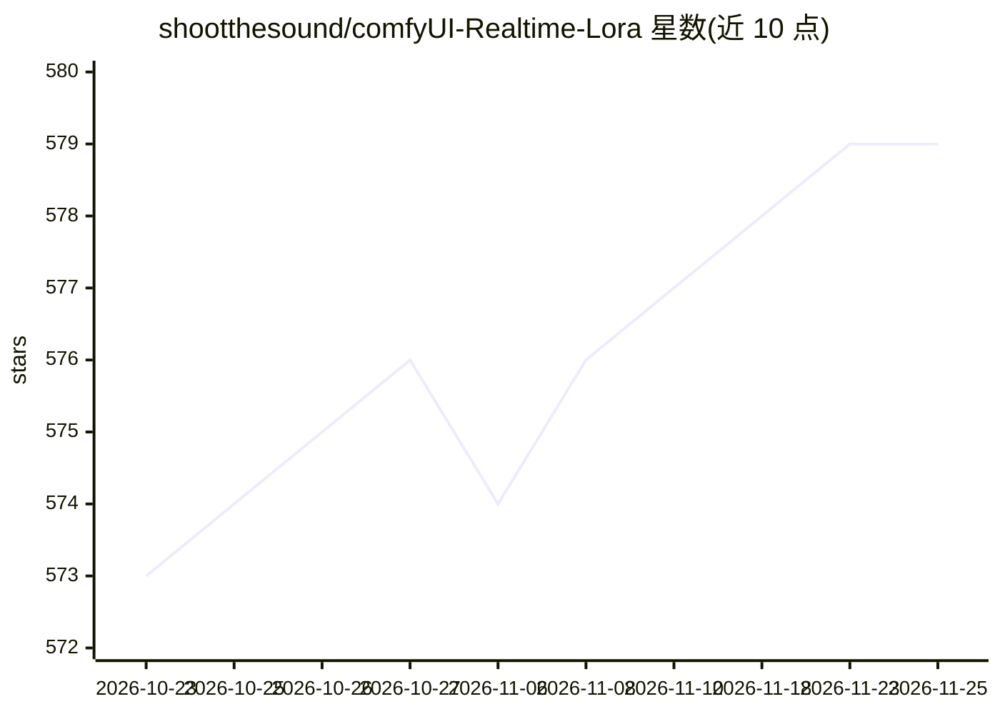

# shootthesound/comfyUI-Realtime-Lora

⭐ 579 · Python · MIT · 推送 2026-11-19 · [GitHub](https://github.com/shootthesound/comfyUI-Realtime-Lora) · 个人维护

**ComfyUI 内直接训练与分块编辑 LoRA 的节点工具包**

以 ComfyUI 自定义节点形式提供的 LoRA 工具包，共 33 个节点：10 个训练节点调用 sd-scripts、Musubi Tuner、AI-Toolkit 三个训练后端，覆盖 SDXL、SD 1.5、Z-Image、FLUX Klein、Qwen Image、Wan 2.2 等架构；另有分析器与按块选择性加载器（支持 LoKR/LoHa/GLoRA 格式）、强度调度（40+ 预设）、LoRA 导出，以及 6 个模型层编辑节点。分析/加载/编辑功能无需额外安装即可使用，仅训练需安装对应后端（Python 3.10-3.12）。

## 筛选速览

| 维度 | 判定 | 备注 |
|---|---|---|
| AI 角色 | `ai-ecosystem` | LLM/agent 周边工具 |
| 许可风险 | `permissive` | MIT |
| 部署形态 | `None` |  |
| 模型依赖 | — | README 未给出锁定关系 |
| 硬件要求 | `gpu-8g` | |
| 安装摩擦 | `medium` | 含编译或系统依赖之一 |
| 成熟度 | — | 结构信号不足 |

## 能力要点

- 3 个训练后端覆盖 8 种架构，训练在 ComfyUI 工作流内完成
- 分块分析与选择性加载，含每块强度控制与调度预设
- 支持 LoKR/LoHa/GLoRA 等多种 LoRA 格式检测
- 6 个模型层编辑节点可缩放基模型各块并存盘

## 适用场景

- 在工作流内训练角色/风格 LoRA 并直接应用
- 对已有 LoRA 做分块分析与按块选择性加载
- 训练 Qwen Image Edit 的图像编辑行为
- 为 Wan 2.2 视频训练首尾帧一致性 LoRA

## 场景标签

`微调` · 领域:训练与推理

## 证据(README 行号)

> L6: **Train**, **analyze**, **selectively load by block**, and **edit base models** for **SDXL, SD 1.5, FLUX, Z-Image, Q
> L146: **For training nodes only** - install the backend(s) you need:

## 星数曲线

2026-10-23 573 → 2026-11-25 579（+6）

---
*卡片 v1 · prompt 1.4 · 生成 2026-11-25 · 置信度 mid · 依据 README sha `6b1f062b62d6` · [字段定义](../../DATASET.md)*
