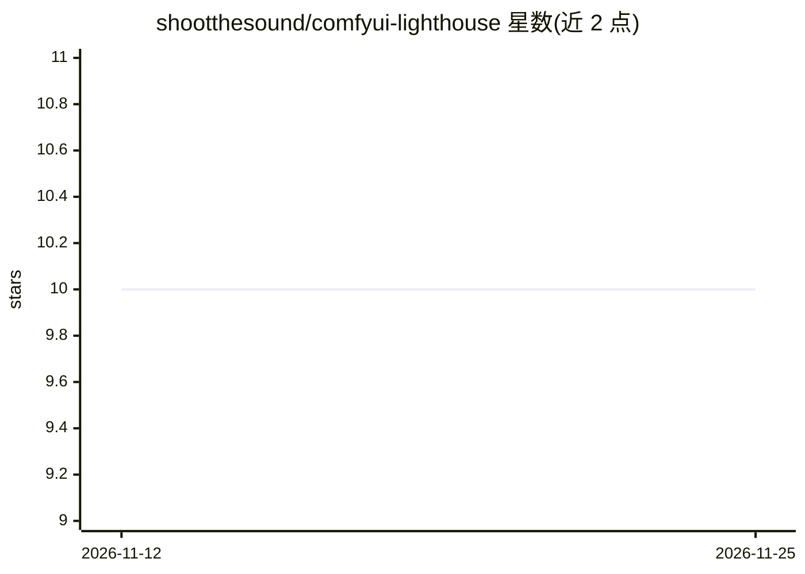

# shootthesound/comfyui-lighthouse

⭐ 10 · JavaScript · 推送 2026-06-07 · [GitHub](https://github.com/shootthesound/comfyui-lighthouse) · 个人维护

**ComfyUI 工作流图距离高亮叠加工具，辅助调试图**

一个 ComfyUI 自定义节点扩展，以非破坏性叠加层形式按图距离高亮节点：右键锚定任一节点后，BFS 计算各节点距离并用红/橙/黄/绿/蓝/紫七色环标注，Focus 滑块可逐环聚焦。用于诊断大型工作流（追踪依赖与消费关系）和学习他人搭建的工作流。纯 JS 前端扩展，不改工作流任何属性；安装方式为将文件夹放入 custom_nodes 并重启。双向遍历上游与下游连接。

## 筛选速览

| 维度 | 判定 | 备注 |
|---|---|---|
| AI 角色 | `ai-ecosystem` | LLM/agent 周边工具 |
| 许可风险 | `none` | — |
| 部署形态 | `None` |  |
| 模型依赖 | — | README 未给出锁定关系 |
| 硬件要求 | — | 无带数字的原话,不猜 |
| 安装摩擦 | `low` | 无编译、无系统依赖或容器化 |
| 成熟度 | — | 结构信号不足 |

## 能力要点

- BFS 计算 node→distance 映射，按跳数七色高亮
- Focus 滑块逐环聚焦，远离锚点的区域渐暗
- 非破坏性：不修改工作流任何属性，关闭后画布复原
- 双向遍历：同时显示上游输入与下游消费链

## 适用场景

- 诊断超过 20 节点的大型工作流，追踪节点间依赖
- 学习从 civitai/GitHub 下载的陌生工作流结构
- 检查模型加载器是否仍被下游消费

## 场景标签

`图像生成` · 领域:内容生成

## 证据(README 行号)

> L3:  A non-destructive overlay that lights up every node by graph distance from the one you click.
> L54: Pure JS extension. When you pick **Anchor from this node**, Lighthouse runs a breadth-first search across `node.inp
> L60: 1. Drop the `comfyui-lighthouse` folder into `ComfyUI/custom_nodes/`.

## 星数曲线

2026-11-12 10 → 2026-11-25 10（+0）

---
*卡片 v1 · prompt 1.4 · 生成 2026-11-19 · 置信度 high · 依据 README sha `30bd04d73eb5` · [字段定义](../../DATASET.md)*
