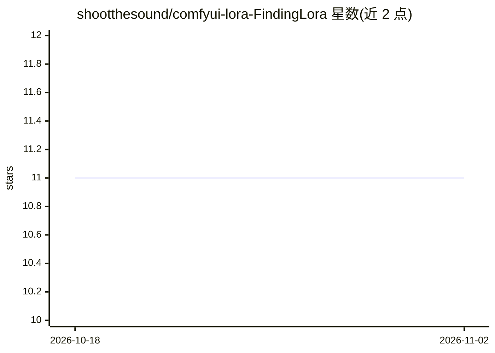

# shootthesound/comfyui-lora-FindingLora

⭐ 11 · JavaScript · 推送 2026-07-23 · [GitHub](https://github.com/shootthesound/comfyui-lora-FindingLora) · 个人维护

**给 ComfyUI 用户的 LoRA 加载节点：书签、触发词、模糊搜索**

ComfyUI 自定义节点包，替代原生 LoRA Loader 的交互：以模态选择器和 fzf 风格模糊搜索取代长下拉列表，支持收藏书签、为书签存储触发词并可点击复制（同时作为 STRING 输出接入提示词编码链）、单节点内最多堆叠 10 个附加强度的 LoRA、保存/载入整套 LoRA 组合，以及一键生成新加载节点并自动接入模型链。书签与组合以 JSON 文件存储于 <ComfyUI>/user/finding-lora/，并在画布各节点间实时同步。属 model-only 加载器，不含 CLIP 输入输出。安装方式为将文件夹放入 custom_nodes/ 后重启 ComfyUI。

## 筛选速览

| 维度 | 判定 | 备注 |
|---|---|---|
| AI 角色 | `ai-ecosystem` | LLM/agent 周边工具 |
| 许可风险 | `none` | — |
| 部署形态 | `None` |  |
| 模型依赖 | — | README 未给出锁定关系 |
| 硬件要求 | — | 无带数字的原话,不猜 |
| 安装摩擦 | `low` | 无编译、无系统依赖或容器化 |
| 成熟度 | — | 结构信号不足 |

## 能力要点

- fzf 风格两层模糊搜索（子串优先于分散子序列），Top 200 结果保持 UI 响应
- 书签与触发词存储，trigger 以 STRING 输出可接入提示词编码链
- 单节点堆叠最多 10 个附加 LoRA，各自独立强度，可保存/载入整套组合
- 一键链式生成新加载节点并自动重接下游 MODEL 连接

## 适用场景

- 管理上千个 LoRA 文件时快速定位所需模型
- 收藏常用 LoRA 并随取随复制其触发词
- 将多个 LoRA 组合保存成套件，之后一键复用

## 场景标签

`图像生成` · 领域:内容生成

## 证据(README 行号)

> L1: Finding LoRA — for ComfyUI
> L3:  A LoRA loader with bookmarks , trigger-word storage and click-to-copy , fuzzy search , a built-in stack of up to 10
> L42: 1. Drop the `comfyui-lora-FindingLora` folder into `ComfyUI/custom_nodes/`.

## 星数曲线

2026-10-18 11 → 2026-11-02 11（+0）

---
*卡片 v1 · prompt 1.4 · 生成 2026-11-01 · 置信度 high · 依据 README sha `1a55cdcb6f23` · [字段定义](../../DATASET.md)*
