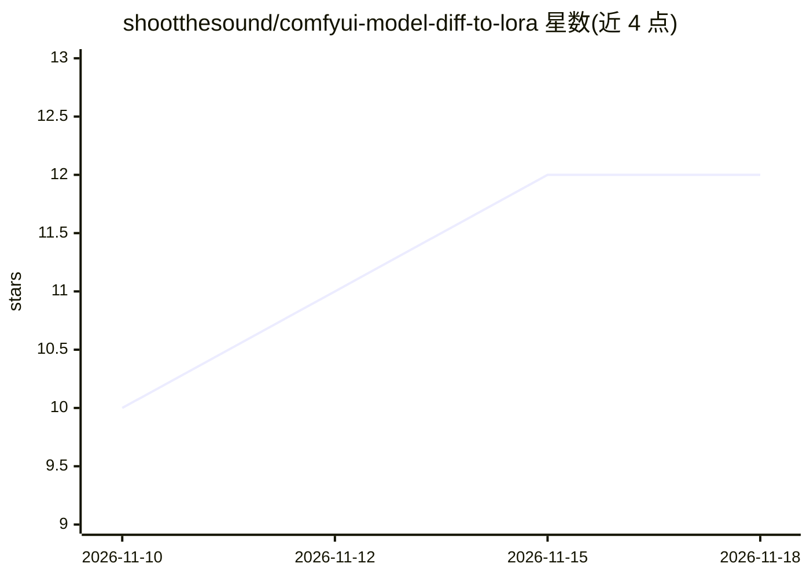

# shootthesound/comfyui-model-diff-to-lora

⭐ 12 · Python · 推送 2026-07-27 · [GitHub](https://github.com/shootthesound/comfyui-model-diff-to-lora) · 个人维护

**ComfyUI 节点：将两个模型差异提取为可分发的 LoRA 文件**

以 ComfyUI 自定义节点形式提供，接收 model_before / model_after 两个 MODEL 对象，对逐张量差异执行 SVD 分解，生成标准 .safetensors 格式的 LoRA 文件；输出在原基座模型上以强度 1.0 加载可复现 after 模型行为。除 LoRA 叠加外，还捕获层级缩放、外部合并、IP-Adapter 等补丁式编辑。一次 SVD 可切片输出多个秩的文件；架构从模型 key 名自动检测，支持 Flux、SDXL、SD 1.5、WAN、Qwen-Image 等。安装仅需放入 custom_nodes 目录，无需额外 pip 依赖。

## 筛选速览

| 维度 | 判定 | 备注 |
|---|---|---|
| AI 角色 | `ai-ecosystem` | LLM/agent 周边工具 |
| 许可风险 | `none` | — |
| 部署形态 | `library` | 以包/库形式分发 |
| 模型依赖 | — | README 未给出锁定关系 |
| 硬件要求 | — | 无带数字的原话,不猜 |
| 安装摩擦 | `medium` | 含编译或系统依赖之一 |
| 成熟度 | — | 结构信号不足 |

## 能力要点

- 一次 SVD 分解可同时导出 8/16/32/64/128/256 多个秩的 LoRA 文件
- 通过 comfy.lora.calculate_weight() 先应用 patches 再计算差异，捕获链式 LoRA 与补丁编辑
- 自动检测模型架构并写入匹配命名，Flux/SDXL/SD1.5/WAN/Qwen-Image 等可直接回载
- 自动跳过数值噪声层以控制文件体积，保存成功后节点自动停用

## 适用场景

- 把常用的一组多 LoRA 叠加组合烘焙成单个文件方便分享
- 用一个 LoRA 文件保存多 LoRA 堆叠预设
- 为外部合并的 checkpoint 生成小体积的差量 LoRA

## 场景标签

 · 领域:生成式 AI/图像生成工具链

## 证据(README 行号)

> L1: Model Diff to LoRA for ComfyUI
> L15: The node walks every trainable weight, computes the per-tensor difference, runs SVD to factor each diff into low-ra
> L66: ## Install

## 星数曲线

2026-11-10 10 → 2026-11-18 12（+2）

---
*卡片 v1 · prompt 1.4 · 生成 2026-11-18 · 置信度 mid · 依据 README sha `79cd2bd5d12f` · [字段定义](../../DATASET.md)*
