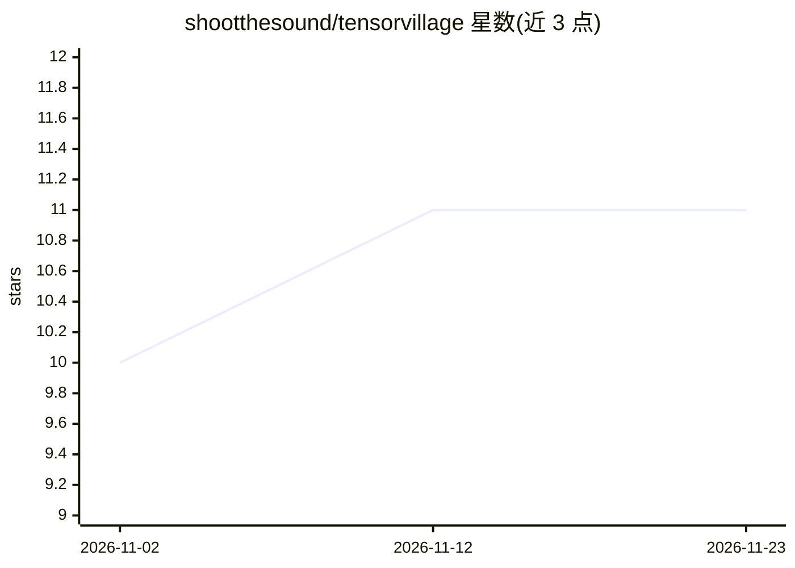

# shootthesound/tensorvillage

⭐ 11 · 推送 2026-09-02 · [GitHub](https://github.com/shootthesound/tensorvillage) · 个人维护

**把散落各盘的 AI 模型文件整合为一个虚拟盘符的 Windows 工具**

基于 WinFsp 的 Windows 文件系统驱动工具：读取 safetensors/GGUF/.pth 等文件头部（不读取张量数据、不反序列化 pickle）识别模型类型与家族，将分散在多块磁盘的模型库实时组装为单一盘符，目录遵循 ComfyUI 命名约定并可一键写入其 extra_model_paths.yaml。附带去重、自定义浏览视图（布局+过滤器）、元数据编辑、Save 落盘区与回收文件夹。安装器按用户级安装并捆绑 WinFsp，支持 Windows 10/11 x64，应用自动更新。

## 筛选速览

| 维度 | 判定 | 备注 |
|---|---|---|
| AI 角色 | `ai-ecosystem` | LLM/agent 周边工具 |
| 许可风险 | `none` | — |
| 部署形态 | `desktop` | 安装包/桌面程序 |
| 模型依赖 | — | README 未给出锁定关系 |
| 硬件要求 | — | 无带数字的原话,不猜 |
| 安装摩擦 | `low` | 无编译、无系统依赖或容器化 |
| 成熟度 | — | 结构信号不足 |

## 能力要点

- 只读文件头部识别模型（tensor 名/形状/元数据），不复制、不移动原文件
- 基于 WinFsp 的真实文件系统，跨磁盘共享单一命名空间
- 按 ComfyUI 目录约定组装，一键写入 extra_model_paths.yaml
- 字节级去重、自定义浏览视图与元数据编辑器，全部免费

## 适用场景

- 把散落在多块硬盘的模型库整合给 ComfyUI 等工具统一访问
- 扫描清理各处重复下载的相同模型文件
- 按基础模型/用途/年份等维度自建浏览树
- 下载文件夹直连，自动识别并归档新模型

## 场景标签

 · 领域:AI 资产管理/桌面工具

## 证据(README 行号)

> L5: No copying. No symlinks. No renaming. It reads each file's header, works out what the
> L56: - **It's a real filesystem, not a pile of links.** Built on WinFsp:
> L181: Tools → **Wire ComfyUI…** (or `tv wire <path>`) adds a managed `tensorvillage:` section

## 星数曲线

2026-11-02 10 → 2026-11-23 11（+1）

---
*卡片 v1 · prompt 1.4 · 生成 2026-11-18 · 置信度 high · 依据 README sha `90bd37745fa8` · [字段定义](../../DATASET.md)*
