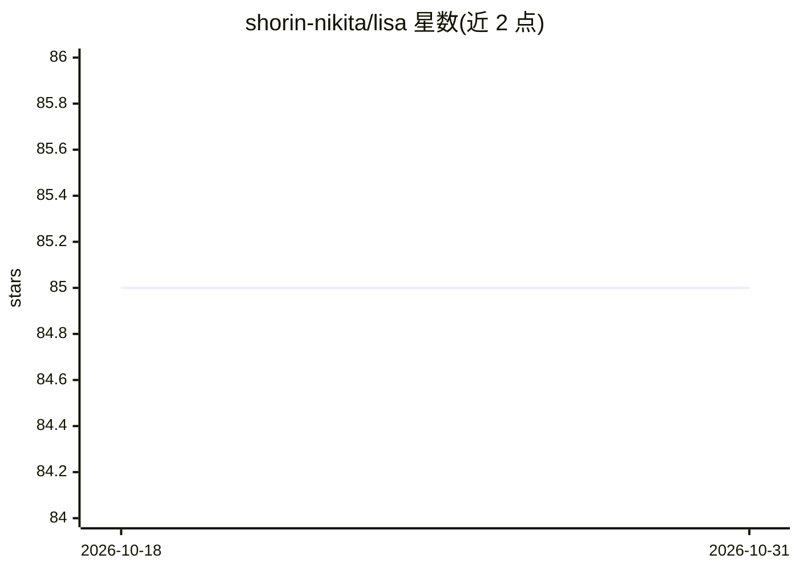

# shorin-nikita/lisa

⭐ 85 · Python · Apache-2.0 · 推送 2026-03-13 · [GitHub](https://github.com/shorin-nikita/lisa) · [官网](https://aibot.direct) · 个人维护 · 中文 README

**自托管本地 AI 平台：n8n+Ollama+Supabase+RAG 一键部署**

面向俄语区商业用户的自托管 AI 平台安装方案：通过一个 Python 安装脚本在 VPS 上以 Docker 容器编排 N8N（工作流自动化）、Ollama（本地 LLM）、Supabase（PostgreSQL+向量检索）、Whisper（语音识别）、Qdrant、Caddy 与 FFmpeg，自动检测 GPU、生成密钥、配置防火墙。内置 Telegram 机器人、RAG 代理、视频转写等预置工作流模板。另设付费社区（5,000₽/月）提供 Bitrix24 CRM 集成与 20+ 工作流。基础版以 Apache 2.0 发布。

## 筛选速览

| 维度 | 判定 | 备注 |
|---|---|---|
| AI 角色 | `ai-ecosystem` | LLM/agent 周边工具 |
| 许可风险 | `permissive` | Apache-2.0 |
| 部署形态 | `None` |  |
| 模型依赖 | local-ok | 支持本地模型 |
| 硬件要求 | — | 无带数字的原话,不猜 |
| 安装摩擦 | `medium` | 含编译或系统依赖之一 |
| 成熟度 | — | 结构信号不足 |

## 能力要点

- 一条脚本部署 N8N/Ollama/Supabase/Qdrant/Whisper 全栈容器
- 安装时自动导入 Telegram Bot、RAG、视频转写等工作流模板
- 脚本自动检测 GPU、生成密钥并配置防火墙
- 本地运行 LLM 与 RAG，数据不外发

## 适用场景

- 在自有服务器上搭建本地 AI 自动化平台，替代订阅制 API 服务
- 部署带语音、记忆的 Telegram 机器人
- 搭建向量检索 RAG 问答代理
- 企业通过 n8n 工作流接入 CRM 与消息渠道

## 场景标签

`工作流自动化` `RAG` `语音识别` `推理引擎` · 领域:效率与自动化

## 证据(README 行号)

> L6: **Бесплатная self-hosted AI платформа** — разверни локальный ИИ на своём сервере за 5 минут.
> L12: - **Всё в одном** — N8N, Ollama, Whisper, Supabase, векторный поиск
> L27: |**Ollama**|Локальные LLM (Llama, Mistral, Gemma)|

## 星数曲线

2026-10-18 85 → 2026-10-31 85（+0）

---
*卡片 v1 · prompt 1.4 · 生成 2026-10-24 · 置信度 high · 依据 README sha `7649bc8ac002` · [字段定义](../../DATASET.md)*
