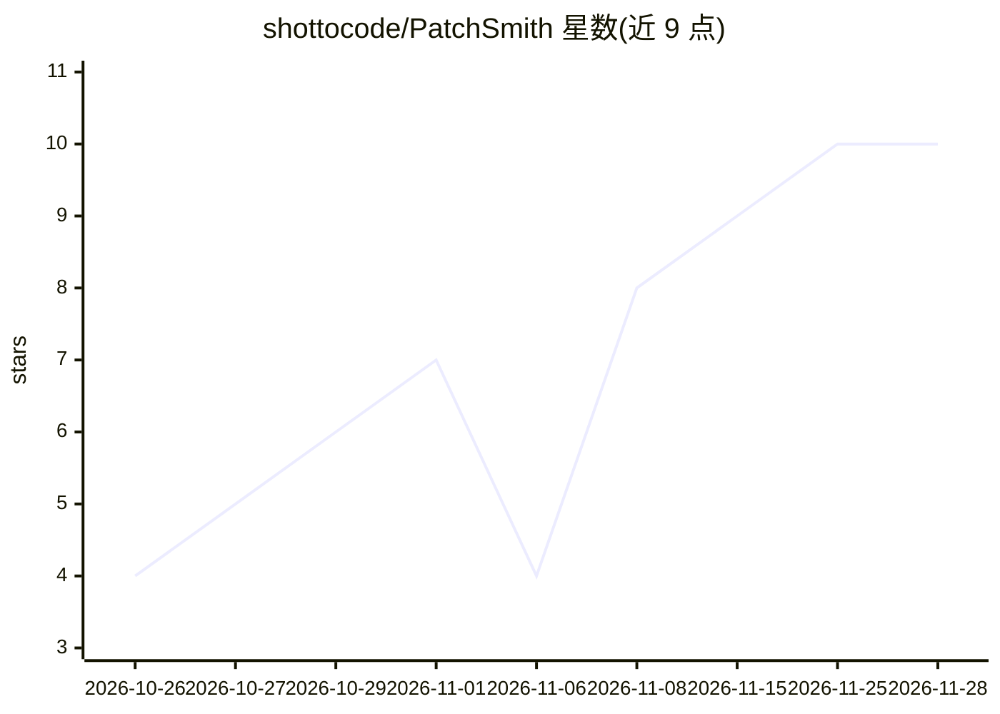

# shottocode/PatchSmith

⭐ 10 · Python · MIT · 推送 2026-11-09 · [GitHub](https://github.com/shottocode/PatchSmith) · 个人维护

**面向 Windows 玩家的游戏文本原生翻译工具**

PatchSmith 自动识别游戏引擎（Unity/Unreal/GameMaker/Godot 等），定位文本并翻译后直接写入游戏文件，附带逐文件备份与一键还原。默认使用本地翻译器（通过 Ollama 运行 Google TranslateGemma 模型），也可配置 DeepL、MyMemory 或非官方 Google 端点。仅支持 Windows，提供打包好的 zip（内含便携 Python）或从 Python 3.10+ 源码运行；不支持加密 paks、模拟器游戏及在线反作弊游戏。

## 筛选速览

| 维度 | 判定 | 备注 |
|---|---|---|
| AI 角色 | `ai-enhanced` | 去掉 AI 部分产品仍成立 |
| 许可风险 | `permissive` | MIT |
| 部署形态 | `desktop` | 安装包/桌面程序 |
| 模型依赖 | local-ok | 支持本地模型 |
| 硬件要求 | — | 无带数字的原话,不猜 |
| 安装摩擦 | `low` | 无编译、无系统依赖或容器化 |
| 成熟度 | `idea` | |

## 能力要点

- 识别 10 类游戏引擎并写入翻译，保留逐文件备份与字节级还原
- 默认本地翻译器（Ollama + TranslateGemma），离线运行无字符上限
- 支持 DeepL、MyMemory、Google 免费端点等多种翻译后端
- 翻译后检查功能：列出未翻译、过长、可疑的行供人工修正

## 适用场景

- 把自己的合法游戏副本翻译成本地语言
- 离线环境下完成游戏文本本地化
- 翻译后校对并修正机器翻译的行

## 场景标签

 · 领域:游戏工具/本地化

## 证据(README 行号)

> L7: PatchSmith automatically translates a video game's text **inside the game itself**, like an official localization: n
> L14: - translates it (by default with a local translator on your PC: no account, no limits);
> L17: Windows only. The interface is in Italian and English (the flag button switches it).

## 星数曲线

2026-10-26 4 → 2026-11-28 10（+6）

---
*卡片 v1 · prompt 1.4 · 生成 2026-11-20 · 置信度 high · 依据 README sha `33ae84ca0949` · [字段定义](../../DATASET.md)*
