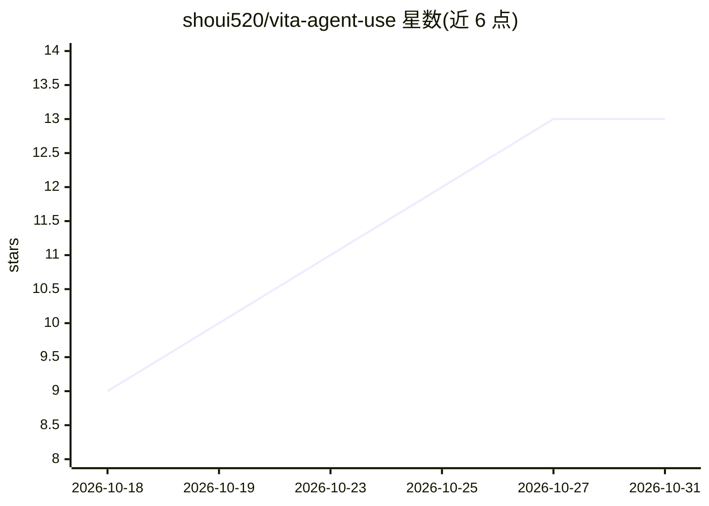

# shoui520/vita-agent-use

⭐ 13 · C · GPL-3.0 · 推送 2026-10-29 · [GitHub](https://github.com/shoui520/vita-agent-use) · 个人维护

**让 AI agent 远程操控 PS Vita 的代理工具（视觉/输入/部署/调试）**

由 Vita 端插件（内核桥、Shell 加载器、Shell 运行时）与 PC 端 Python CLI 组成的 agent 工具链：Claude、Codex、Gemini 等 agent 可截屏查看画面、注入按键与多点触控、安装 VPK、启动应用、实时接收崩溃转储与日志事件、采集 CPU/FPS/内存指标，并可一键完成部署-启动-监控-清理的测试循环。安全机制包括配对确认、危险操作在掌机上二次确认、config.txt 差异审查、删除先入回收站、互 TLS 加密。需 Vita 3.65 + VitaSDK 自行编译插件。

## 筛选速览

| 维度 | 判定 | 备注 |
|---|---|---|
| AI 角色 | `ai-ecosystem` | LLM/agent 周边工具 |
| 许可风险 | `viral` | GPL-3.0 |
| 部署形态 | `library` | 以包/库形式分发 |
| 模型依赖 | — | README 未给出锁定关系 |
| 硬件要求 | — | 无带数字的原话,不猜 |
| 安装摩擦 | `medium` | 含编译或系统依赖之一 |
| 成熟度 | — | 结构信号不足 |

## 能力要点

- 截屏/按键/多点触控输入 + 每游戏宏，供 agent 视觉与操作
- 实时推送崩溃转储、错误对话框、日志与 CPU/FPS/内存指标
- 一键测试循环：部署-启动-等待崩溃或日志-采集指标-清理
- 安全机制：配对确认、PS+SELECT 急停、危险改动掌机侧确认、互 TLS

## 适用场景

- 让 agent 自动构建、部署并试玩我的 PS Vita 自制软件，读日志修 bug
- 自动化 Vita 上的应用安装、文件传输与崩溃调试
- 长时间 agent 会话中远程采集性能指标与崩溃转储

## 场景标签

`GUI 自动化` · 领域:效率与自动化

## 证据(README 行号)

> L5: vita-agent-use is like computer use for AI agents, but for a PS Vita. An agent such as Claude, Codex or Gemini can s
> L33: │ AI agent                    │                   │ vita_agent_loader.suprx  (*main)    │

## 星数曲线

2026-10-18 9 → 2026-10-31 13（+4）

---
*卡片 v1 · prompt 1.4 · 生成 2026-10-31 · 置信度 mid · 依据 README sha `b0de16b8340d` · [字段定义](../../DATASET.md)*
