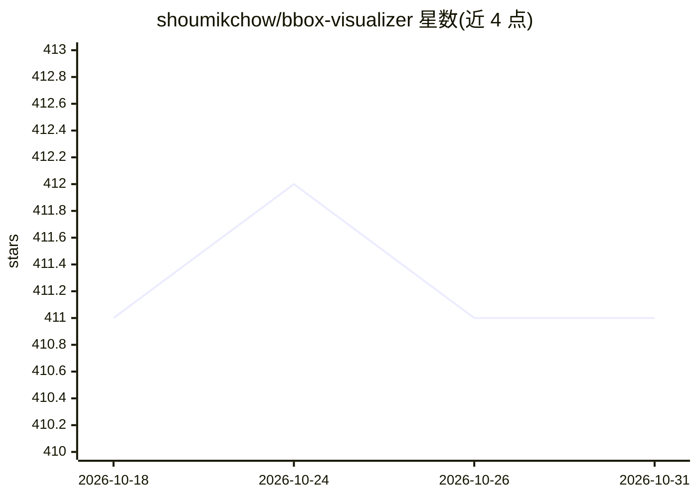

# shoumikchow/bbox-visualizer

⭐ 411 · Python · MIT · 推送 2026-07-17 · [GitHub](https://github.com/shoumikchow/bbox-visualizer) · [官网](https://bbox-visualizer.readthedocs.io) · 个人维护

**在图像上绘制并标注边界框的 Python 可视化库**

Python 库 bbox-visualizer：读取图像与边界框坐标，绘制边界框并自动定位标签，省去手工计算标签位置。默认接受 Pascal VOC 格式坐标，通过 bbox_format 参数支持 COCO 与 YOLO 格式（内部统一转换为 VOC 再绘制）。提供标签置顶、T 型标签、旗帜标签、不透明叠加等多种标注样式及对应多目标变体；所有函数返回新图像且不修改输入。面向计算机视觉开发者与数据标注场景，pip 安装，附 examples/ 示例脚本。

## 筛选速览

| 维度 | 判定 | 备注 |
|---|---|---|
| AI 角色 | `ai-ecosystem` | LLM/agent 周边工具 |
| 许可风险 | `permissive` | MIT |
| 部署形态 | `library` | 以包/库形式分发 |
| 模型依赖 | — | README 未给出锁定关系 |
| 硬件要求 | — | 无带数字的原话,不猜 |
| 安装摩擦 | `low` | 无编译、无系统依赖或容器化 |
| 成熟度 | — | 结构信号不足 |

## 能力要点

- 绘制边界框并自动定位标签，无需手工计算坐标
- 支持 Pascal VOC/COCO/YOLO 三种边界框格式（bbox_format 参数）
- 多种标签样式：置顶、T 型、旗帜、不透明叠加及多目标变体
- 函数返回新图像，不修改输入图像

## 适用场景

- 目标检测结果的可视化与标注展示
- 数据标注与检查时批量绘制多目标边界框
- 将不同格式的检测框统一可视化

## 场景标签

`图像视频处理` · 领域:感知与多模态

## 证据(README 行号)

> L10: This package helps users draw bounding boxes around objects, without doing the clumsy math that you'd need to do fo
> L12: By default the bounding box points are expected in Pascal VOC format: `(xmin, ymin, xmax, ymax)`. COCO and YOLO for

## 星数曲线

2026-10-18 411 → 2026-10-31 411（+0）

---
*卡片 v1 · prompt 1.4 · 生成 2026-10-21 · 置信度 high · 依据 README sha `62f10739c2d1` · [字段定义](../../DATASET.md)*
