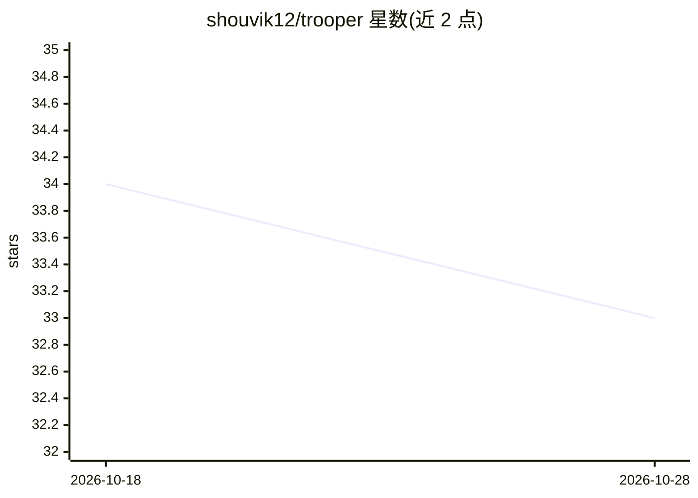

# shouvik12/trooper

⭐ 33 · Go · 推送 2026-06-18 · [GitHub](https://github.com/shouvik12/trooper) · 个人维护

**给开发者：本地优先的 LLM 代理与聊天界面，带降级链**

Go 编写的本地 LLM 网关与工作台：代理请求并在 Claude/Gemini/OpenAI/Ollama 之间做智能路由与降级链（如 Claude→Ollama），云端失败或配额耗尽时自动回落本地并保留上下文。内置 ANCHOR/SITREP/TAIL 三段式上下文压缩（可配置上限默认 6144 tokens）、零侵入的 agent 可观测性 dashboard，以及本地优先的 Chat UI，支持一键升级到 Claude 且会话记忆跨提供方流动。提供 Docker Compose 与源码两种运行方式，兼容 Anthropic/OpenAI SDK 经 base_url 接入。

## 筛选速览

| 维度 | 判定 | 备注 |
|---|---|---|
| AI 角色 | `ai-ecosystem` | LLM/agent 周边工具 |
| 许可风险 | `none` | — |
| 部署形态 | `self-host` | docker 或自建部署 |
| 模型依赖 | local-ok | 支持本地模型 |
| 硬件要求 | — | 无带数字的原话,不猜 |
| 安装摩擦 | `low` | 无编译、无系统依赖或容器化 |
| 成熟度 | — | 结构信号不足 |

## 能力要点

- 提供者降级链（Claude→Gemini/OpenAI→Ollama），失败回落本地且上下文保留
- ANCHOR/SITREP/TAIL 三段式上下文压缩，默认上限 6144 tokens
- 本地优先 Chat UI，一键升级到 Claude 并注入完整会话上下文
- 零侵入 agent 可观测性：X-Trooper-* 响应头暴露路由决策

## 适用场景

- 让 agent 默认走本地 Ollama，需要推理能力时一键升级到云端模型
- 云端 API 配额或故障时自动回落本地模型，任务不中断
- 通过 dashboard 观察 agent 的 LLM 调用与路由决策

## 场景标签

`模型网关` `聊天机器人` `LLM 可观测性` · 领域:Agent 开发

## 证据(README 行号)

> L20: **Trooper is a zero-instrumentation agent observability platform with local fallback — and now a local-first chat i
> L160: CLAUDE_API_KEY=sk-ant-... # Chain: Claude → Ollama

## 星数曲线

2026-10-18 34 → 2026-10-28 33（-1）

---
*卡片 v1 · prompt 1.4 · 生成 2026-10-25 · 置信度 high · 依据 README sha `3fdba3d5fcd2` · [字段定义](../../DATASET.md)*
