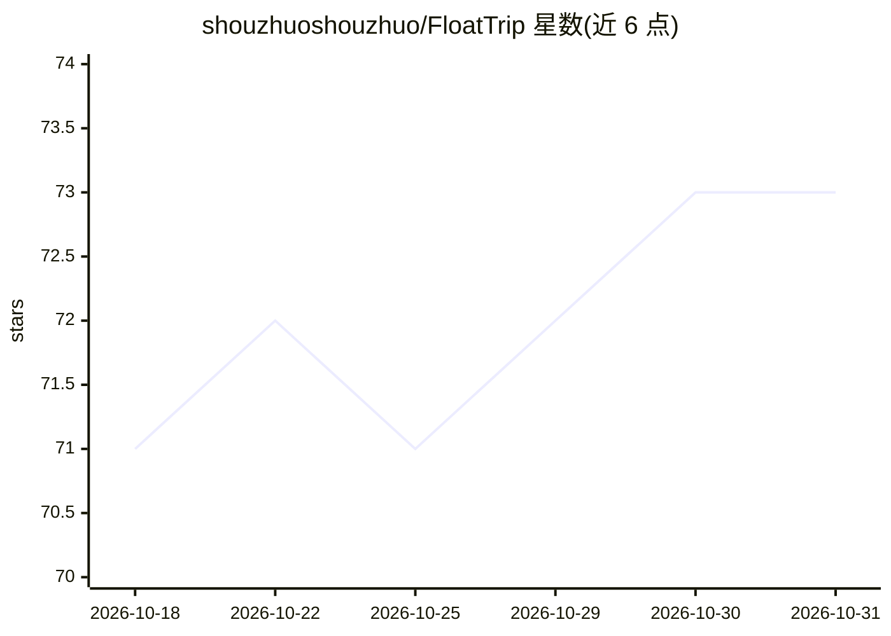

# shouzhuoshouzhuo/FloatTrip

⭐ 73 · Python · 推送 2026-09-26 · [GitHub](https://github.com/shouzhuoshouzhuo/FloatTrip) · 个人维护 · 中文 README

**对话式旅行规划 Agent：POI 数据+约束求解生成逐日行程**

面向旅行者的 Web 应用：通过对话 Agent 澄清目的地、日期与约束，查询高德真实 POI 与天气，由 LLM 补充候选语义，再经 OR-Tools CP-SAT 优化器完成选点、排序与排程，并对已有行程继续对话修改或拖拽编辑。模型接入支持 DeepSeek / 豆包（环境变量配置），需自备 API Key；Runtime 持久化任务状态，支持 SSE 回放、取消与重试，当前面向单节点部署。提供 React Native 移动端复用同一后端。

## 筛选速览

| 维度 | 判定 | 备注 |
|---|---|---|
| AI 角色 | `ai-native` | 本体是模型或模型工具 |
| 许可风险 | `none` | — |
| 部署形态 | `library` | 以包/库形式分发 |
| 模型依赖 | locked-api |  |
| 硬件要求 | — | 无带数字的原话,不猜 |
| 安装摩擦 | `low` | 无编译、无系统依赖或容器化 |
| 成熟度 | — | 结构信号不足 |

## 能力要点

- ReAct 主 Agent 澄清需求并维护 Planning Brief 与长期旅行记忆
- 高德真实 POI/天气 + OR-Tools CP-SAT 优化器排程，非 LLM 直接编排
- 行程可对话修改、拖拽编辑、撤销重做，保存时服务端重算距离
- 任务持久化 Runtime：排队、SSE 回放、取消、重试，SQLite checkpoint

## 适用场景

- 一句话旅行想法生成可编辑的逐日行程
- 带着偏好记忆持续调整出行计划
- 在同一工作区查看对话、路线与地图并手动调整行程

## 场景标签

 · 领域:旅行规划/AI 应用

## 证据(README 行号)

> L7: 对话 Agent 理解需求，真实 POI 提供地点依据，约束求解编排行程。
> L27: |**真实地点，算法排程**|查询高德 POI 与天气，由模型补充候选语义，再通过优化器选择、排序和安排时间，并进行质量检查。|
> L145: |模型接入|DeepSeek / 豆包，支持环境变量配置|

## 星数曲线

2026-10-18 71 → 2026-10-31 73（+2）

---
*卡片 v1 · prompt 1.4 · 生成 2026-10-24 · 置信度 mid · 依据 README sha `4ae07df879d1` · [字段定义](../../DATASET.md)*
