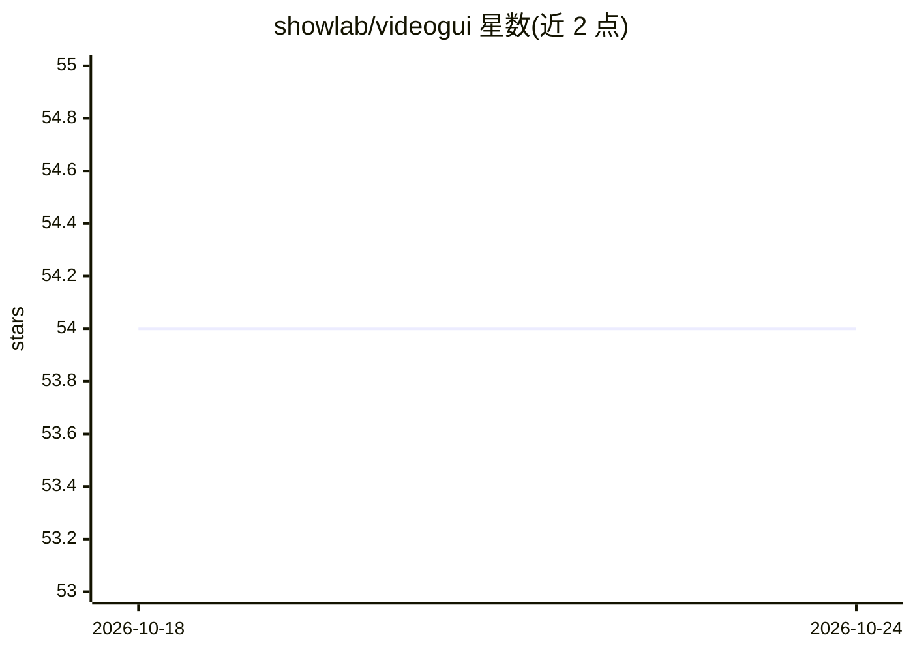

# showlab/videogui

⭐ 55 · JavaScript · 推送 2026-02-22 · [GitHub](https://github.com/showlab/videogui) · [官网](https://showlab.github.io/videogui/) · 组织维护

**基于教学视频的 GUI 自动化多模态评测基准数据集**

NeurIPS 2024 D&B 接收的多模态基准：从专业软件（PR/AE/DaVinci、Stable Diffusion、Runway 等）的高质量教学视频中采集新颖任务，由标注者复现操作过程，提供含视觉查询（起始/结束帧或视频）、工程文件（如 .drp）、屏幕录制（.mkv）、动作元数据（_full.json）与有序截图的分层标注，支持分层规划与动作评测。数据通过 Google Drive 与 Hugging Face 数据集发布，评测代码与指标实现标注为待上传，线上环境搭建参考 GUI-Thinker 教程。

## 筛选速览

| 维度 | 判定 | 备注 |
|---|---|---|
| AI 角色 | `ai-knowledge` | 知识聚合/清单类 |
| 许可风险 | `none` | — |
| 部署形态 | `None` |  |
| 模型依赖 | — | README 未给出锁定关系 |
| 硬件要求 | — | 无带数字的原话,不猜 |
| 安装摩擦 | `low` | 无编译、无系统依赖或容器化 |
| 成熟度 | — | 结构信号不足 |

## 能力要点

- 面向 PR/AE/DaVinci 等专业视频编辑与视觉创作软件的任务集
- 任务源自教学视频并经标注者复现操作
- 分层标注：规划流程与录制的动作序列
- 数据含视觉查询、工程文件、屏幕录制与动作元数据

## 适用场景

- 评测多模态 agent 在专业软件上的 GUI 自动化能力
- 研究以视觉预览而非文本指令驱动的任务执行
- 做分层规划与动作两级的评测分析

## 场景标签

`模型评测` `GUI 自动化` · 领域:效率与自动化

## 证据(README 行号)

> L18: > **TL;DR:** A Multi-modal Benchmark for Visual-centric GUI Automation from Instructional Videos.
> L22: **Visual-centric softwares and tasks:** VideoGUI focuses on professional and novel software like PR and AE for vide
> L26: **Hierarchical planning and actions:** We provide detailed annotations with planning procedures and recorded action

## 星数曲线

2026-10-18 54 → 2026-10-24 54（+0）

---
*卡片 v1 · prompt 1.4 · 生成 2026-10-24 · 置信度 high · 依据 README sha `a8cc09aa0850` · [字段定义](../../DATASET.md)*
