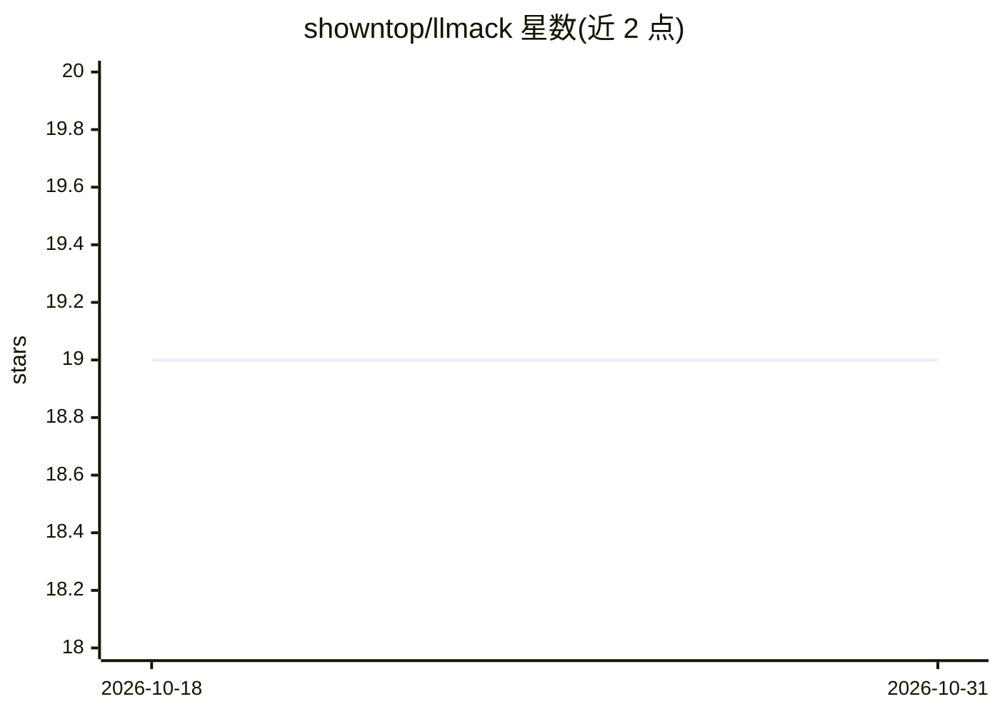

# showntop/llmack

⭐ 19 · Go · MIT · 推送 2026-01-21 · [GitHub](https://github.com/showntop/llmack) · 个人维护

**Go 语言全栈 LLM 应用开发框架**

面向 Go 开发者的 LLM 应用开发框架，提供 LLM 交互（如 GPT、Claude）、提示词管理、RAG、语音处理、程序化工作流、参数与提示词优化及编排引擎等组件。通过 go get 安装为 Go 库使用，代码内调用各模块构建应用，example 目录提供更多示例。MIT 许可证。

## 筛选速览

| 维度 | 判定 | 备注 |
|---|---|---|
| AI 角色 | `ai-ecosystem` | LLM/agent 周边工具 |
| 许可风险 | `permissive` | MIT |
| 部署形态 | `library` | 以包/库形式分发 |
| 模型依赖 | — | README 未给出锁定关系 |
| 硬件要求 | — | 无带数字的原话,不猜 |
| 安装摩擦 | `low` | 无编译、无系统依赖或容器化 |
| 成熟度 | — | 结构信号不足 |

## 能力要点

- LLM 交互组件支持 GPT、Claude 等模型
- 集成 RAG、语音处理与提示词管理
- 提供编排引擎与工作流的程序化控制
- 包含参数与提示词优化器组件

## 适用场景

- 用 Go 构建接入多种 LLM 的应用
- 在 Go 项目中实现 RAG 与语音交互
- 以工作流方式编排 LLM 各组件

## 场景标签

`RAG` `提示工程` `Agent 框架` · 领域:Agent 开发

## 证据(README 行号)

> L5: The GoLang Fullstack LLM Framework is a comprehensive toolkit designed to facilitate the development of applications
> L9: - **LLM Integration**: Interact with various Large Language Models (e.g., GPT, Claude) for text generation, summariz

## 星数曲线

2026-10-18 19 → 2026-10-31 19（+0）

---
*卡片 v1 · prompt 1.4 · 生成 2026-10-28 · 置信度 high · 依据 README sha `b53db6fc6c8a` · [字段定义](../../DATASET.md)*
