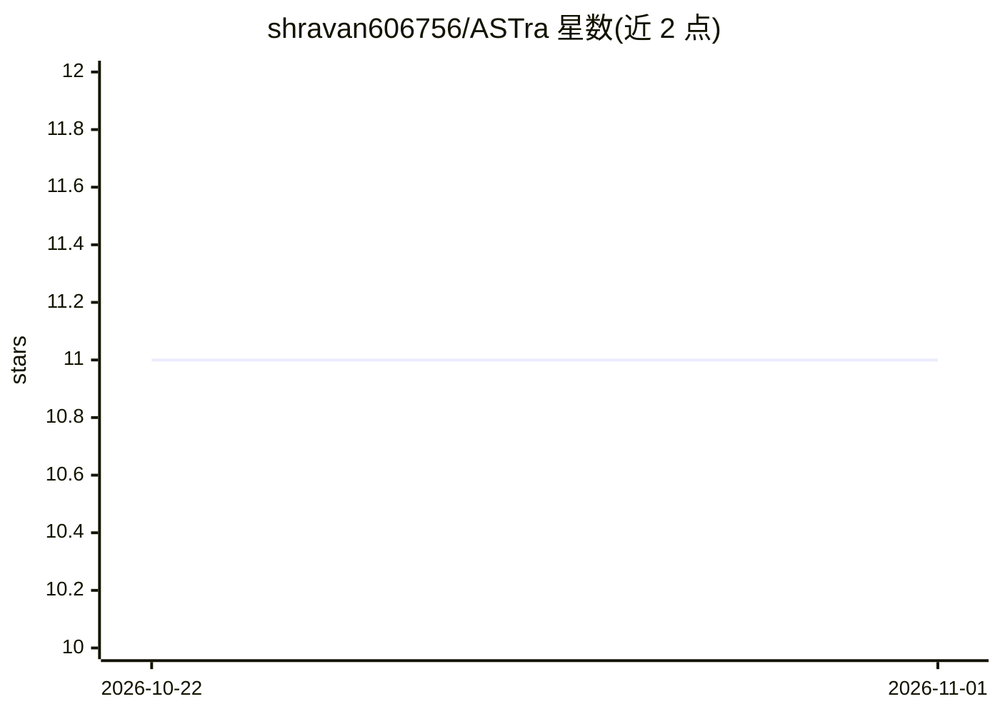

# shravan606756/ASTra

⭐ 11 · Java · MIT · 推送 2026-10-29 · [GitHub](https://github.com/shravan606756/ASTra) · 个人维护

**Java 代码库 AST 解析+语义索引问答服务，自然语言查代码**

基于 Spring Boot 的 REST 服务：用 JavaParser 在 AST 层解析 Java 代码库，按类/方法边界切块，经 Ollama 生成向量存入 PostgreSQL/pgvector，查询时做 ANN 检索并交给 LLM 产出带精确类/文件/行号引用的回答。提供 9 种查询命令（class/method/architecture/workflow/dependencies 等）、内置检索质量基准端点和 Windows 原生 CLI 伴侣。面向需要理解陌生大型 Java 代码库的开发者；限 Java 语言、需本地 Ollama 与 Groq API key。

## 筛选速览

| 维度 | 判定 | 备注 |
|---|---|---|
| AI 角色 | `ai-native` | 本体是模型或模型工具 |
| 许可风险 | `permissive` | MIT |
| 部署形态 | `self-host` | docker 或自建部署 |
| 模型依赖 | local-ok | 支持本地模型 |
| 硬件要求 | — | 无带数字的原话,不猜 |
| 安装摩擦 | `low` | 无编译、无系统依赖或容器化 |
| 成熟度 | — | 结构信号不足 |

## 能力要点

- AST 级解析与符号表解析，保留类层级与交叉引用
- pgvector 向量检索 + LLM 回答，附精确源码引用
- 多线程自适应批处理索引（示例代码库 1,700+ 类约 7.5 分钟）
- 内置检索质量基准：准确率与延迟指标可自行复现

## 适用场景

- 接手陌生 Java 项目时用自然语言追问类、方法与架构
- 追踪某方法的所有调用方或端到端工作流
- 对已索引仓库运行检索质量基准验证效果

## 场景标签

`RAG` `语义搜索` · 领域:知识与检索

## 证据(README 行号)

> L17: ASTra parses Java codebases at the AST level and turns them into a searchable, semantic index you can query in plai
> L71: |`POST`|`/api/v1/chat`|Ask a natural-language question and get a grounded, source-referenced answer|
> L114: - **Natural language Q&A** - Top-K retrieved code context feeds an LLM under a strict token budget, with provider 

## 星数曲线

2026-10-22 11 → 2026-11-01 11（+0）

---
*卡片 v1 · prompt 1.4 · 生成 2026-11-01 · 置信度 high · 依据 README sha `7cb8ba562baa` · [字段定义](../../DATASET.md)*
