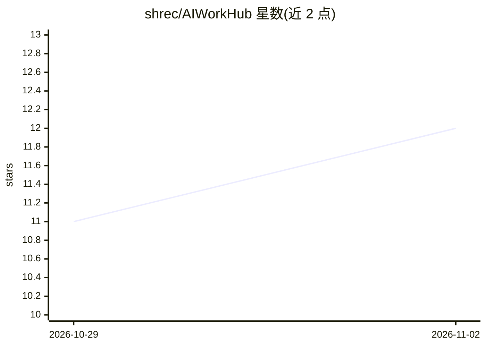

# shrec/AIWorkHub

⭐ 12 · Python · MIT · 推送 2026-11-01 · [GitHub](https://github.com/shrec/AIWorkHub) · [官网](https://shrec.github.io/AIWorkHub/) · 组织维护

**本地优先的多模型 AI 编码 agent 控制平面（VS Code/MCP）**

开源的 AI 编码 agent 管理层：将 Claude Code、Codex、Copilot 等作为 worker 运行，把项目拆分为依赖感知的任务卡（DAG），按成本路由到不同模型执行，变更经测试与独立 reviewer 审查后才合入。提供仓库级 Source Graph 索引、会话/记忆/知识库上下文、证据留痕（diff、测试、工具回执）与存储归档生命周期。以 VS Code 扩展、MCP stdio 服务（wheel/uvx）和 Docker 镜像三种形式分发；需 Python 3.12+ 与 VS Code 1.93+，面向在编辑器内已授权模型的开发者。

## 筛选速览

| 维度 | 判定 | 备注 |
|---|---|---|
| AI 角色 | `ai-ecosystem` | LLM/agent 周边工具 |
| 许可风险 | `permissive` | MIT |
| 部署形态 | `desktop` | 安装包/桌面程序 |
| 模型依赖 | — | README 未给出锁定关系 |
| 硬件要求 | — | 无带数字的原话,不猜 |
| 安装摩擦 | `low` | 无编译、无系统依赖或容器化 |
| 成熟度 | — | 结构信号不足 |

## 能力要点

- 任务依赖 DAG + 隔离 worker + manager 审查闭环
- 模型组合路由：困难判断留给高价模型，吞吐任务路由到低价模型
- 语义编辑：worker 修改哈希校验的行区间，不整文件重写
- MCP over stdio，任意 MCP 客户端可接入

## 适用场景

- 把大型编码项目拆成任务卡，交给多个 AI agent 并行执行并统一审查
- 控制多模型 token 成本，按任务难度路由到不同价位的模型
- 在 VS Code 或任意 MCP 客户端中以本地优先方式管理 AI 编码工作流

## 场景标签

`编码 Agent` `多智能体` `代码审查` · 领域:Agent 开发

## 证据(README 行号)

> L5:  An AI manager that runs Claude Code, Codex and Copilot as its workers.
> L169: AIWorkHub is an open-source control plane for multi-model AI coding agents.
> L170: Codex, Claude, Copilot, DeepSeek and GLM are not products it tries to replace;

## 星数曲线

2026-10-29 11 → 2026-11-02 12（+1）

---
*卡片 v1 · prompt 1.4 · 生成 2026-11-01 · 置信度 mid · 依据 README sha `bd13dcd0a3fa` · [字段定义](../../DATASET.md)*
