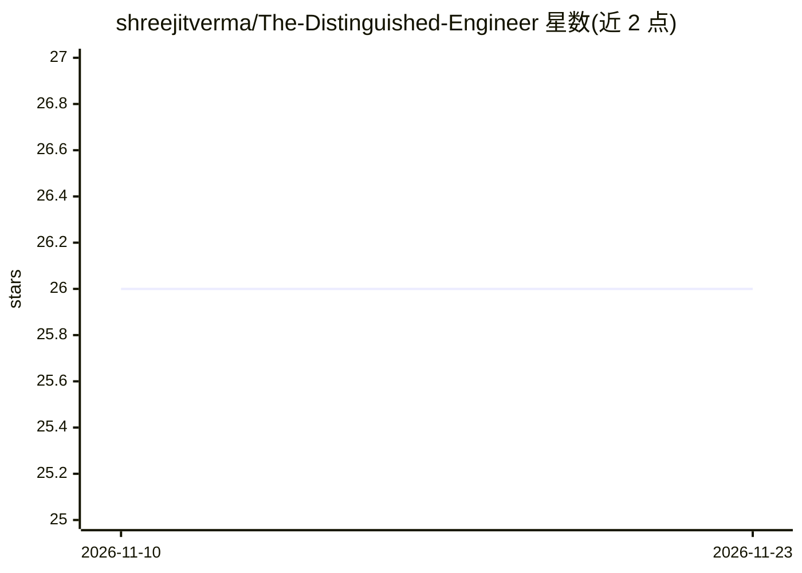

# shreejitverma/The-Distinguished-Engineer

⭐ 26 · Python · MIT · 推送 2026-11-22 · [GitHub](https://github.com/shreejitverma/The-Distinguished-Engineer) · [官网](https://www.shreejitverma.com/open-source/the-distinguished-engineer) · 个人维护

**从初级到杰出工程师的知识库与可运行课程**

自 2021 年持续维护的个人工程知识库，兼作课程、参考库与可运行代码：覆盖 CS 基础、C++/Python 指南、约 6,800 道 DSA 题解、系统设计、量化金融与低延迟交易系统（129 篇 Obsidian 笔记）、14 卷 agentic AI 课程、16 卷云 AI 课程、开发者工具链与 Shell 工程，另含约 159 篇论文阅读笔记。以 Obsidian vault 形式组织，笔记带类型化 frontmatter，代码各自独立编译运行，无统一构建系统。

## 筛选速览

| 维度 | 判定 | 备注 |
|---|---|---|
| AI 角色 | `ai-knowledge` | 知识聚合/清单类 |
| 许可风险 | `permissive` | MIT |
| 部署形态 | `None` |  |
| 模型依赖 | — | README 未给出锁定关系 |
| 硬件要求 | — | 无带数字的原话,不猜 |
| 安装摩擦 | `medium` | 含编译或系统依赖之一 |
| 成熟度 | — | 结构信号不足 |

## 能力要点

- 约 6,800 道 DSA 题解（C++/Python），按模式组织
- 14 卷 agentic AI 课程：从 LLM 基础到多智能体、MCP、评测
- 129 篇低延迟交易系统笔记与量化金融代码（订单簿、回测器）
- 约 159 篇技术论文的阅读笔记与公开链接索引

## 适用场景

- 按目标岗位（SDE/量化/低延迟/AI 工程）选择学习路径
- 准备高级别工程面试（系统设计、Raft、无锁编程等实现）
- 系统学习 agentic AI 与云 AI 工程课程

## 场景标签

`教程课程` `金融量化` · 领域:学习与行业

## 证据(README 行号)

> L3: A single, opinionated knowledge base for going from junior engineer to distinguished engineer, with dedicated tracks
> L4: It is part curriculum, part reference vault, part runnable code.
> L20: |Agentic AI|14-volume curriculum from LLM foundations to multi-agent systems, MCP, evals, and coding agents, plus a

## 星数曲线

2026-11-10 26 → 2026-11-23 26（+0）

---
*卡片 v1 · prompt 1.4 · 生成 2026-11-18 · 置信度 high · 依据 README sha `f0a7b858e18b` · [字段定义](../../DATASET.md)*
