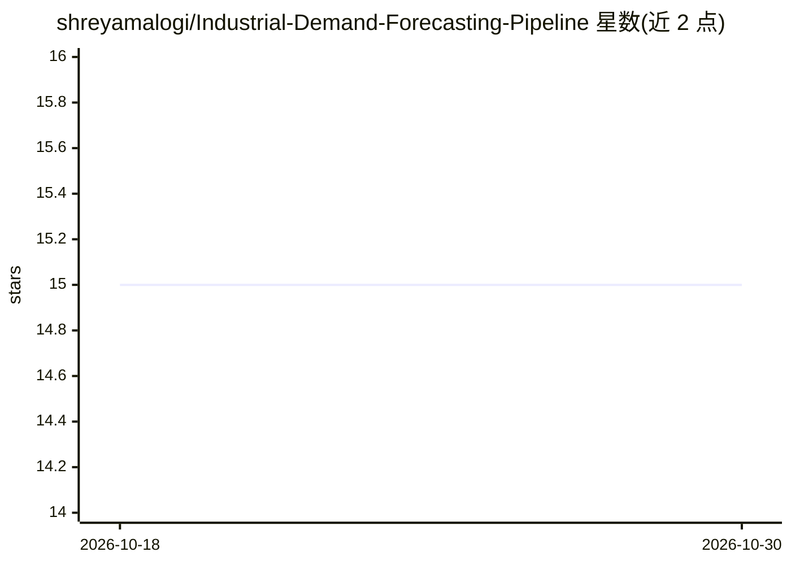

# shreyamalogi/Industrial-Demand-Forecasting-Pipeline

⭐ 15 · Jupyter Notebook · MIT · 推送 2026-02-03 · [GitHub](https://github.com/shreyamalogi/Industrial-Demand-Forecasting-Pipeline) · 个人维护

**基于 LightGBM 的零售需求预测流水线（15M 交易数据）**

面向 Walmart M5 数据集的需求预测流水线项目：通过 Kaggle API 将约 1,527 万条销售记录摄取到云端环境，用自定义降 casting（int8/int16/float32）降低约 70% 内存占用，进行宽表转长表、节假日与 SNAP 指标合并、滞后与滚动均值特征工程，再以 Tweedie 目标的 LightGBM 处理零膨胀销售分布，按 90/10 时间切分训练验证，输出 28 天需求预测。项目以 Colab 笔记本形式运行，README 未提供独立安装命令。

## 筛选速览

| 维度 | 判定 | 备注 |
|---|---|---|
| AI 角色 | `ai-native` | 本体是模型或模型工具 |
| 许可风险 | `permissive` | MIT |
| 部署形态 | `None` |  |
| 模型依赖 | — | README 未给出锁定关系 |
| 硬件要求 | — | 无带数字的原话,不猜 |
| 安装摩擦 | `low` | 无编译、无系统依赖或容器化 |
| 成熟度 | — | 结构信号不足 |

## 能力要点

- 处理 15,275,490 条记录的 ETL 与预测流水线
- 自定义数值降 casting 降低约 70% 内存占用
- Tweedie-LightGBM 处理零售零膨胀销售分布
- 90/10 时间切分并输出 28 天预测

## 适用场景

- 零售/供应链场景下做多门店商品的未来 28 天需求预测
- 学习大规模表格时序数据的 ETL 与特征工程设计
- 参考零膨胀分布下 Tweedie 目标函数的使用方式

## 场景标签

 · 领域:零售/时序机器学习

## 证据(README 行号)

> L10: This project documents the design of a **production-grade Machine Learning pipeline** deployed in the cloud, built 
> L44:  Adopted the **Tweedie regression objective**, ideal for modeling zero-inflated sales distributions common in retai

## 星数曲线

2026-10-18 15 → 2026-10-30 15（+0）

---
*卡片 v1 · prompt 1.4 · 生成 2026-10-30 · 置信度 high · 依据 README sha `80eab9aea6c9` · [字段定义](../../DATASET.md)*
