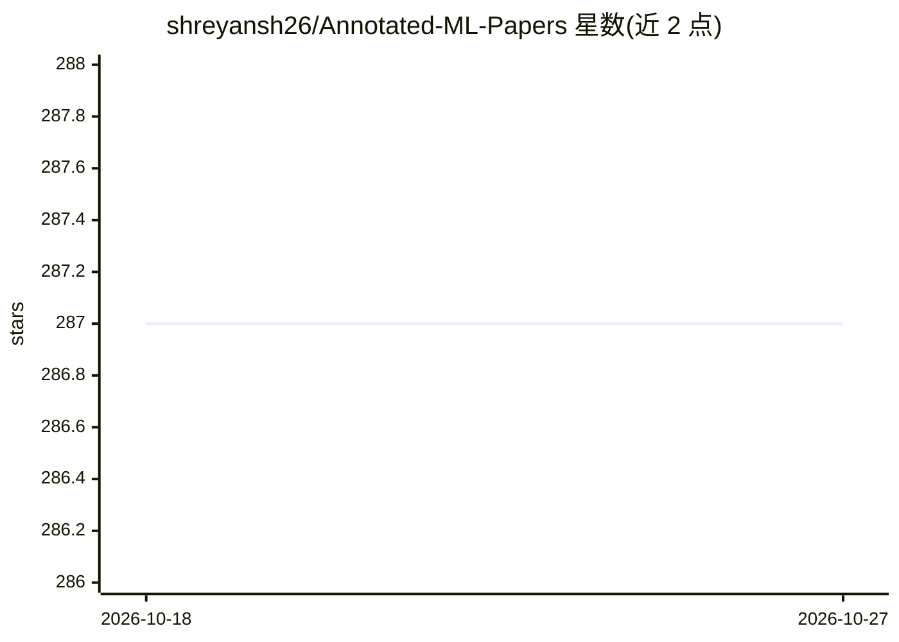

# shreyansh26/Annotated-ML-Papers

⭐ 287 · MIT · 推送 2026-10-05 · [GitHub](https://github.com/shreyansh26/Annotated-ML-Papers) · [官网](https://shreyansh26.github.io/post/) · 个人维护

**个人阅读的 ML/DL 论文注释与解读合集**

作者个人维护的机器学习/深度学习论文注释仓库，收录其阅读的论文并附注释，部分论文在作者博客上另有总结文章。主题覆盖 BERT、GPT/GPT-2、XLNet、Megatron-LM、Transformers 等 NLP 方向。README 仅含简介与邮件订阅、打赏链接，无安装运行说明，以阅读浏览方式使用。

## 筛选速览

| 维度 | 判定 | 备注 |
|---|---|---|
| AI 角色 | `ai-knowledge` | 知识聚合/清单类 |
| 许可风险 | `permissive` | MIT |
| 部署形态 | `None` |  |
| 模型依赖 | — | README 未给出锁定关系 |
| 硬件要求 | — | 无带数字的原话,不猜 |
| 安装摩擦 | `low` | 无编译、无系统依赖或容器化 |
| 成熟度 | — | 结构信号不足 |

## 能力要点

- 收录个人阅读的 ML/DL 论文注释
- 主题覆盖 BERT、GPT-2、XLNet、Megatron-LM、Transformers
- 部分论文在作者博客有对应总结

## 适用场景

- 查找 NLP 经典论文的注释解读
- 跟随他人阅读路径了解重要 ML 论文

## 场景标签

`教程课程` · 领域:学习与行业

## 证据(README 行号)

> L1: # Annotated-ML-Papers
> L2: Annotations of the interesting ML/DL papers I read. I sometimes write a paper summary about them on my blog as well.

## 星数曲线

2026-10-18 287 → 2026-10-27 287（+0）

---
*卡片 v1 · prompt 1.4 · 生成 2026-10-22 · 置信度 mid · 依据 README sha `9559f9226aa0` · [字段定义](../../DATASET.md)*
