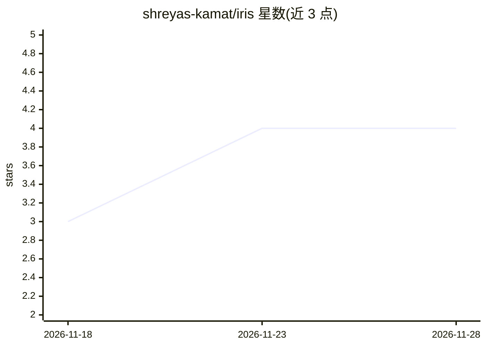

# shreyas-kamat/iris

⭐ 4 · Dart · Apache-2.0 · 推送 2026-11-26 · [GitHub](https://github.com/shreyas-kamat/iris) · [官网](https://iris.shreyaskamat.in/) · 个人维护

**自托管 Hermes Agent 的直连手机客户端**

一款 Flutter 编写的开源手机应用（Android 可构建，iOS 尚未构建运行），作为 Hermes Agent 内置 Web 仪表盘（默认端口 9119）的控制端。功能包括流式聊天与工具调用审批、sudo/密钥确认、会话管理、语音通话、cron 任务与看板、多 profile 切换。手机端不承担计算，agent 与数据留在用户硬件上；不含 agent 本体或托管服务。需要先运行一个 Hermes 仪表盘才能使用。

## 筛选速览

| 维度 | 判定 | 备注 |
|---|---|---|
| AI 角色 | `ai-ecosystem` | LLM/agent 周边工具 |
| 许可风险 | `permissive` | Apache-2.0 |
| 部署形态 | `None` |  |
| 模型依赖 | — | README 未给出锁定关系 |
| 硬件要求 | — | 无带数字的原话,不猜 |
| 安装摩擦 | `low` | 无编译、无系统依赖或容器化 |
| 成熟度 | — | 结构信号不足 |

## 能力要点

- 直连自建服务器：无中继、无账号、无分析/崩溃上报
- 聊天中可审批/拒绝命令、中途引导（steer）、队列/中断策略、撤销与分支
- 语音通话交互，支持免提、按键说话与后台持续通话
- 密码存于 Android Keystore/iOS Keychain，明文 http 仅限局域网/私网地址

## 适用场景

- 在手机上远程控制并监督自己运行的 Hermes Agent
- 通过 Tailscale 或 Cloudflare Access 从外网安全连接家里/服务器上的 agent
- 用语音与 agent 交互或处理其发起的密码、连接器请求

## 场景标签

`聊天机器人` `AI 助手` · 领域:对话与助手

## 证据(README 行号)

> L9: The phone is a control plane, not a compute plane. The agent, its tools and your data stay on your
> L11: reporting.** It needs a Hermes dashboard to talk to; it does not include an agent or a hosted service.
> L20: - **Chat.** Streaming replies with Markdown, code highlighting, visible reasoning and tool calls.

## 星数曲线

2026-11-18 3 → 2026-11-28 4（+1）

---
*卡片 v1 · prompt 1.4 · 生成 2026-11-21 · 置信度 high · 依据 README sha `37a21190b3b0` · [字段定义](../../DATASET.md)*
