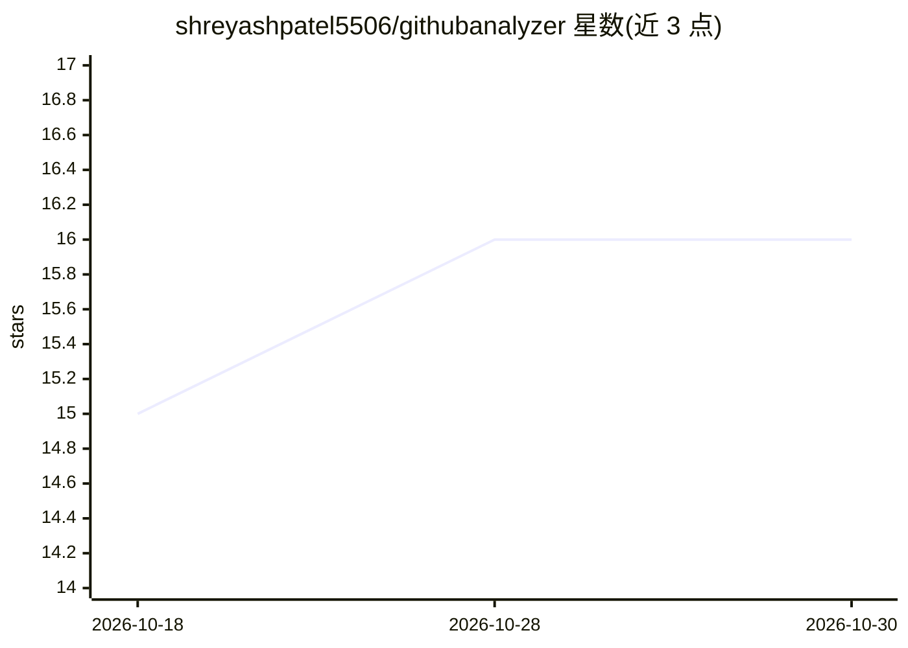

# shreyashpatel5506/githubanalyzer

⭐ 16 · TypeScript · NOASSERTION · 推送 2026-07-21 · [GitHub](https://github.com/shreyashpatel5506/githubanalyzer) · [官网](https://gitprofileai.vercel.app) · 个人维护

**AI 驱动的 GitHub 仓库分析器：代码异味与风险检测**

ClarityCode 是基于 Next.js 的 Web 应用，通过 GitHub API 扫描仓库，分析代码架构、语言与依赖，结合多个 AI 模型（Groq、OpenAI、Gemini）级联生成代码异味、依赖风险、安全问题和架构热点的洞察。后端使用 Supabase PostgreSQL 与 Edge Functions，包含本地计费逻辑与 PayPal 订阅激活。README 明确警示仓库中提交了环境变量和 API key，需轮换泄露密钥并清理历史。

## 筛选速览

| 维度 | 判定 | 备注 |
|---|---|---|
| AI 角色 | `ai-native` | 本体是模型或模型工具 |
| 许可风险 | `none` | NOASSERTION |
| 部署形态 | `library` | 以包/库形式分发 |
| 模型依赖 | locked-api |  |
| 硬件要求 | — | 无带数字的原话,不猜 |
| 安装摩擦 | `low` | 无编译、无系统依赖或容器化 |
| 成熟度 | — | 结构信号不足 |

## 能力要点

- 仓库扫描引擎：分析代码架构、语言与依赖
- Groq/OpenAI/Gemini 多模型级联路由 fallback
- PayPal 订阅激活与本地用量计费
- 基于 Next.js + Supabase 的全栈实现

## 适用场景

- 我想快速了解一个 GitHub 仓库的代码质量与风险点
- 分析仓库的技术栈构成与依赖风险
- 以订阅形式提供仓库扫描服务

## 场景标签

`代码审查` `网络安全` · 领域:编码与开发

## 证据(README 行号)

> L3: ClarityCode analyzes GitHub repositories to surface code smells, dependency risks, security issues, and architectura
> L8: - **Multi-AI Routing**: Capable of cascading through Groq, OpenAI, and Gemini for fallback completions.

## 星数曲线

2026-10-18 15 → 2026-10-30 16（+1）

---
*卡片 v1 · prompt 1.4 · 生成 2026-10-30 · 置信度 high · 依据 README sha `14adf3d83997` · [字段定义](../../DATASET.md)*
