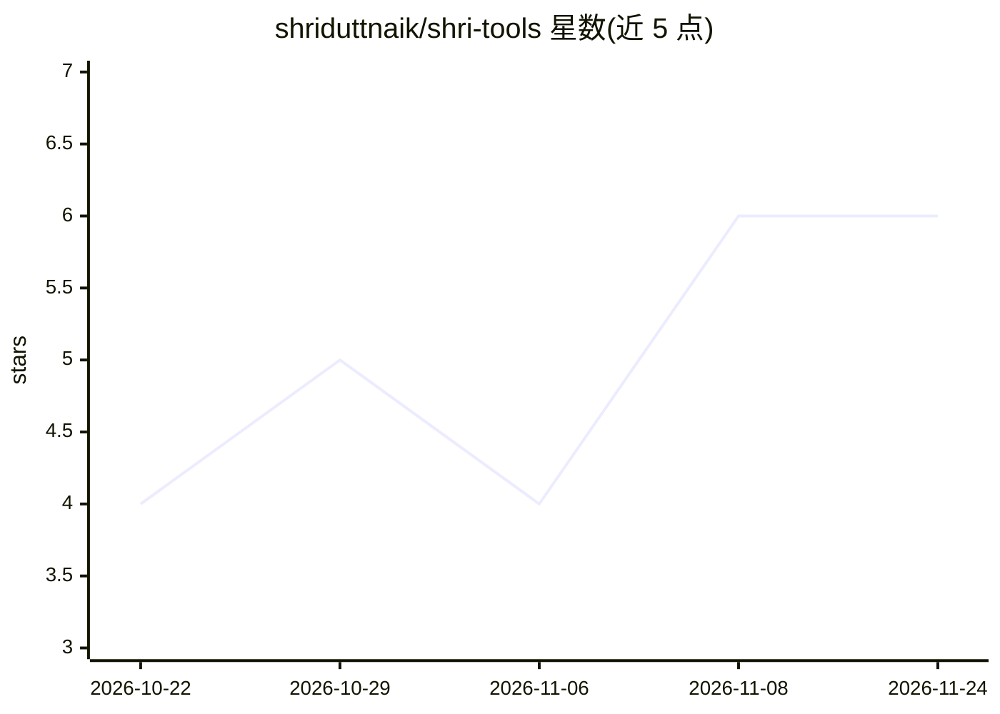

# shriduttnaik/shri-tools

⭐ 6 · Python · NOASSERTION · 推送 2026-10-27 · [GitHub](https://github.com/shriduttnaik/shri-tools) · 个人维护

**离线 AI 工作室：在 4 GB 显存笔记本上生成卡通剧集与音乐视频**

面向 Windows 游戏笔记本用户的本地视频生产应用：输入创意后自动完成写故事、逐场景画图、生成带配音口型的动作片段、音乐与歌词对齐，并自带视觉/语音质检，不合格画面与片段自动重做，最终产出成片、三条 Shorts、缩略图与 YouTube 文案。依赖 ComfyUI + Ollama 本地运行，也可选接云端故事模型；每镜头固定 5 秒以规避长片段漂移，1.5 分钟成片约需 4 小时。

## 筛选速览

| 维度 | 判定 | 备注 |
|---|---|---|
| AI 角色 | `ai-native` | 本体是模型或模型工具 |
| 许可风险 | `none` | NOASSERTION |
| 部署形态 | `desktop` | 安装包/桌面程序 |
| 模型依赖 | local-ok | 支持本地模型 |
| 硬件要求 | `gpu-8g` | |
| 安装摩擦 | `medium` | 含编译或系统依赖之一 |
| 成熟度 | — | 结构信号不足 |

## 能力要点

- 故事→分镜→视频→Shorts 全流程离线生成，无需账号与 API 费用
- 自检机制：图片、音词、视频、歌曲四类检查并自动重做
- 12 种印度语言一键换语言复用画面
- 定时调度、Telegram bot 与 n8n API 工作流自动化

## 适用场景

- 在低配笔记本上离线制作儿童向 3D 卡通短片
- 为 YouTube 频道批量生产带 Shorts 与文案的剧集
- 制作多语言版本的同一角色故事视频

## 场景标签

`图像生成` `视频生成` · 领域:内容生成

## 证据(README 行号)

> L11:  Make talking AI cartoon and cinematic episodes - and music videos - on an ordinary gaming laptop (4 GB GPU), fully
> L13: You type an idea. Shri Tools writes the story, draws every scene with the same characters, makes each scene move,
> L55: - 🤖 **It can run by itself** - schedules ("a new episode every Monday"), a Telegram bot for your phone, and an API

## 星数曲线

2026-10-22 4 → 2026-11-24 6（+2）

---
*卡片 v1 · prompt 1.4 · 生成 2026-11-20 · 置信度 high · 依据 README sha `21019ca7682e` · [字段定义](../../DATASET.md)*
