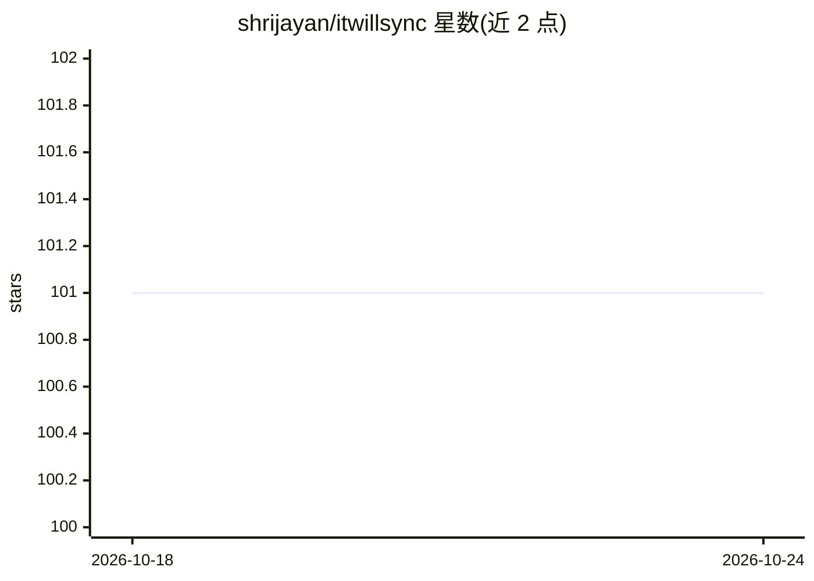

# shrijayan/itwillsync

⭐ 101 · TypeScript · MIT · 推送 2026-10-22 · [GitHub](https://github.com/shrijayan/itwillsync) · [官网](https://shrijayan.github.io/itwillsync/) · 个人维护

**把终端里的 AI 编码 agent 同步到手机上远程操控**

通过 npx 启动的 CLI 工具：将 Claude Code、Aider、Codex 等任意终端型 AI 编码 agent 的会话经本地网络或 Tailscale 投射到手机浏览器，扫码即用、无需装 app。提供多会话仪表盘（agent 状态、工作目录、uptime、WebSocket 实时更新）、注意提醒（检测 BEL/OSC 信号）与移动端优化终端（额外按键条、自动重连）。通信用 NaCl secretbox 端到端加密、每会话随机 64 字符 token、失败限速锁定，数据不出本地网络。需 Node.js 20+。

## 筛选速览

| 维度 | 判定 | 备注 |
|---|---|---|
| AI 角色 | `ai-ecosystem` | LLM/agent 周边工具 |
| 许可风险 | `permissive` | MIT |
| 部署形态 | `library` | 以包/库形式分发 |
| 模型依赖 | — | README 未给出锁定关系 |
| 硬件要求 | — | 无带数字的原话,不猜 |
| 安装摩擦 | `low` | 无编译、无系统依赖或容器化 |
| 成熟度 | — | 结构信号不足 |

## 能力要点

- npx 一条命令启动，扫码后在手机浏览器获得完整终端控制
- 多会话仪表盘：状态/工作目录/uptime 实时更新与注意提醒
- 本地 WiFi / Tailscale / localhost 三种连接模式
- 端到端加密（NaCl secretbox）+ 会话 token + 限速锁定，无账号无遥测

## 适用场景

- 离开工位时用手机查看并批准 AI agent 的操作
- 在一个仪表盘里同时监控多个编码 agent 会话
- 外出时通过 Tailscale 远程接管本地 agent 终端

## 场景标签

 · 领域:开发者工具/AI agent 运维

## 证据(README 行号)

> L3: **Sync any terminal-based AI coding agent to your phone over local network.**
> L10: Sync any coding agent to your phone — one dashboard for all your sessions. Agent-agnostic, privacy-first, zero clou
> L39:  - Claude Code, Aider, Codex, Goose, Cline — if it runs in a terminal, it works

## 星数曲线

2026-10-18 101 → 2026-10-24 101（+0）

---
*卡片 v1 · prompt 1.4 · 生成 2026-10-23 · 置信度 high · 依据 README sha `3074861c3300` · [字段定义](../../DATASET.md)*
