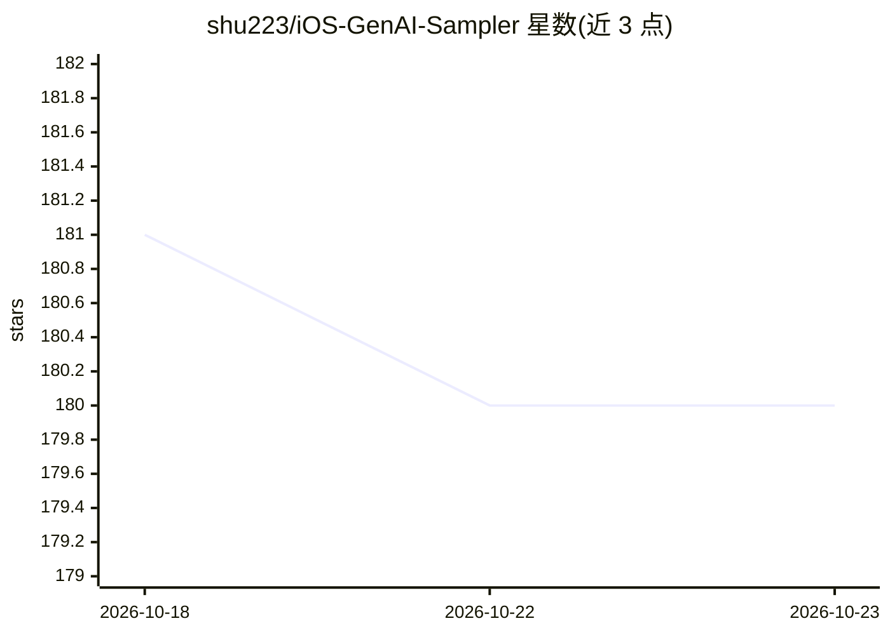

# shu223/iOS-GenAI-Sampler

⭐ 180 · Swift · MIT · 推送 2025-10-28 · [GitHub](https://github.com/shu223/iOS-GenAI-Sampler) · 个人维护

**iOS 生成式 AI 示例集合：OpenAI/本地 LLM/翻译/绘图/语音**

面向 iOS 开发者的生成式 AI 示例代码合集，以 Swift 工程形式提供。示例覆盖 OpenAI API 的文本聊天、流式输出、GPT-4o 图像/视频理解与实时视频理解，Perplexity 搜索 API，基于 GGUF 的本地 LLM（Phi-3、Gemma 2B、Mistral-7B），Apple Translation 框架翻译，Core ML 上 Stable Diffusion v2.1/XL 端侧图像生成，以及 WhisperKit 端侧语音识别。使用方式为重命名 APIKey 样例文件填入密钥后编译运行，实时示例需真机（模拟器不可用），部分翻译示例在 iOS 18 分支。

## 筛选速览

| 维度 | 判定 | 备注 |
|---|---|---|
| AI 角色 | `ai-knowledge` | 知识聚合/清单类 |
| 许可风险 | `permissive` | MIT |
| 部署形态 | `None` |  |
| 模型依赖 | — | README 未给出锁定关系 |
| 硬件要求 | — | 无带数字的原话,不猜 |
| 安装摩擦 | `low` | 无编译、无系统依赖或容器化 |
| 成熟度 | — | 结构信号不足 |

## 能力要点

- OpenAI API 文本聊天、流式输出与 GPT-4o 多模态理解示例
- GGUF 格式本地 LLM 示例（Phi-3 / Gemma 2B / Mistral-7B）
- Core ML 端侧 Stable Diffusion v2.1 与 XL 图像生成
- WhisperKit 端侧语音识别与 Apple Translation 框架示例

## 适用场景

- iOS 开发者学习如何在应用中接入 OpenAI 等生成式 AI API
- 在 iPhone/iPad 上运行本地 LLM 与端侧图像生成
- 参考端侧语音识别与系统翻译框架的实现方式

## 场景标签

`教程课程` `图像生成` `语音识别` · 领域:内容生成

## 证据(README 行号)

> L3: A collection of Generative AI examples on iOS.
> L22: ### OpenAI API Examples

## 星数曲线

2026-10-18 181 → 2026-10-23 180（-1）

---
*卡片 v1 · prompt 1.4 · 生成 2026-10-22 · 置信度 high · 依据 README sha `43e707be3cf2` · [字段定义](../../DATASET.md)*
