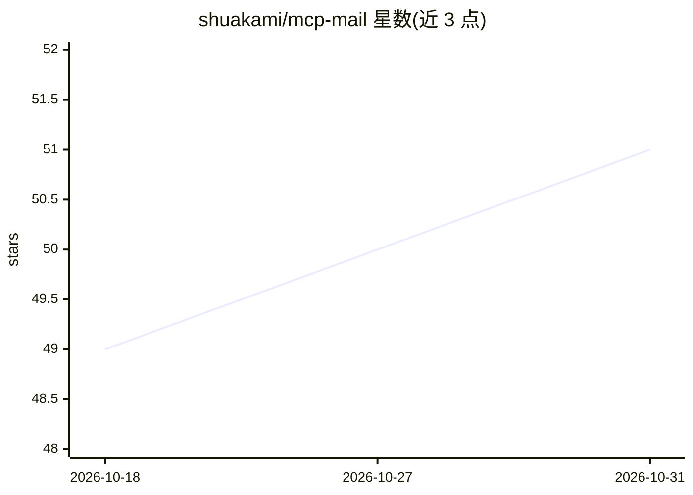

# shuakami/mcp-mail

⭐ 51 · TypeScript · 推送 2025-11-12 · [GitHub](https://github.com/shuakami/mcp-mail) · 个人维护 · 中文 README

**让 AI 助手通过 MCP 收发和管理电子邮件的工具**

基于 MCP (Model Context Protocol) 标准实现的邮件工具服务器，作为 AI 模型与电子邮件服务之间的桥梁：底层用 nodemailer (SMTP) 与 node-imap (IMAP)、mailparser 解析邮件，Zod 做请求验证。支持发送文本/HTML/带附件邮件、文件夹查询、多条件高级搜索、标记/删除/移动邮件、附件下载预览、联系人提取等功能。邮件操作在本地处理，不通过第三方服务器转发。面向使用 Cursor 或 Claude Desktop 的开发者与用户，提供 Smithery 一键安装与源码构建两种方式，需 Node.js、npm、Git 与 Python 3.1+ 环境。

## 筛选速览

| 维度 | 判定 | 备注 |
|---|---|---|
| AI 角色 | `ai-ecosystem` | LLM/agent 周边工具 |
| 许可风险 | `none` | — |
| 部署形态 | `library` | 以包/库形式分发 |
| 模型依赖 | — | README 未给出锁定关系 |
| 硬件要求 | — | 无带数字的原话,不猜 |
| 安装摩擦 | `low` | 无编译、无系统依赖或容器化 |
| 成熟度 | — | 结构信号不足 |

## 能力要点

- 邮件发送/接收/管理/附件/联系人全功能封装为标准化 MCP 工具
- 多文件夹、关键词、日期范围、发件人等高级搜索
- 邮件操作本地处理，不通过第三方服务器转发敏感信息
- 支持 Smithery 自动安装到 Claude Desktop

## 适用场景

- 在 Cursor 中用自然语言让 AI 收发和搜索邮件
- 让 AI 助手整理收件箱、处理附件与联系人
- 为支持 MCP 的客户端接入邮箱能力

## 场景标签

 · 领域:开发工具/邮件自动化

## 证据(README 行号)

> L13: 这是一个基于 MCP (Model Context Protocol) 的邮件工具，它能让 AI 模型通过标准化接口访问电子邮件服务。
> L174: 本工具基于 **MCP (Model Context Protocol)** 标准实现，作为 AI 模型与电子邮件服务之间的桥梁。它使用 **nodemailer** 和 **node-imap** 作为底层邮件客户端，并通过 

## 星数曲线

2026-10-18 49 → 2026-10-31 51（+2）

---
*卡片 v1 · prompt 1.4 · 生成 2026-10-24 · 置信度 high · 依据 README sha `9342ed4c943c` · [字段定义](../../DATASET.md)*
