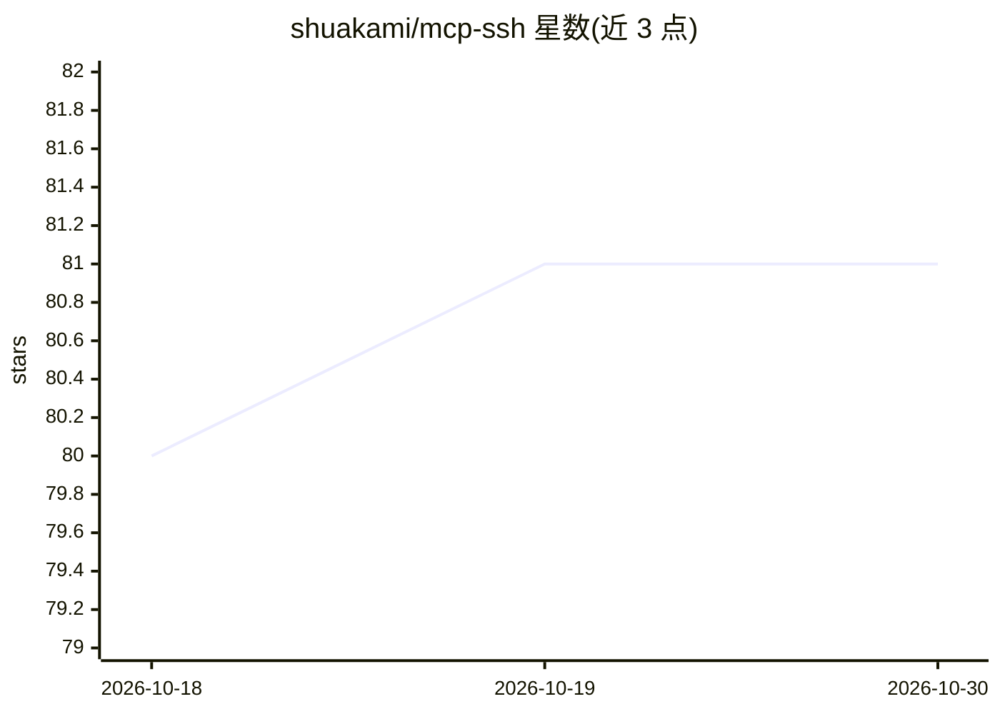

# shuakami/mcp-ssh

⭐ 81 · TypeScript · 推送 2026-08-06 · [GitHub](https://github.com/shuakami/mcp-ssh) · 个人维护 · 中文 README

**MCP 协议 SSH 工具：让 AI 模型远程执行 SSH 操作**

基于 Model Context Protocol 的 SSH 工具，作为 AI 模型与远程服务器之间的桥梁：提供连接管理、命令执行（含复合命令与阻塞检测）、tmux 会话管理、文件上传下载与进程监控，每个操作封装为标准化 MCP 工具。底层使用 node-ssh 客户端与 Zod 请求验证。面向在 Cursor 等 MCP 宿主中使用 AI 助手的开发者，通过自然语言完成远程运维操作。安装方式为 git clone 源码构建或 Docker 容器运行，README 同时列出 Python 3.11+ 与 Node.js 环境要求，tmux 需安装在远程服务器上。

## 筛选速览

| 维度 | 判定 | 备注 |
|---|---|---|
| AI 角色 | `ai-ecosystem` | LLM/agent 周边工具 |
| 许可风险 | `none` | — |
| 部署形态 | `self-host` | docker 或自建部署 |
| 模型依赖 | — | README 未给出锁定关系 |
| 硬件要求 | — | 无带数字的原话,不猜 |
| 安装摩擦 | `low` | 无编译、无系统依赖或容器化 |
| 成熟度 | — | 结构信号不足 |

## 能力要点

- SSH 连接管理与命令执行封装为 MCP 工具
- tmux 会话创建、按键发送与输出捕获
- 阻塞进程自动检测与超时处理（最长10分钟）
- 提供 Docker 运行方式与数据卷持久化配置

## 适用场景

- 在 Cursor 中用自然语言管理远程服务器连接与命令执行
- 通过 tmux 持久化会话处理长时间运行或需协作的远程任务
- 让 AI 助手上传下载远程文件、查看日志

## 场景标签

 · 领域:开发运维工具/MCP

## 证据(README 行号)

> L12: 这是一个基于 MCP (Model Context Protocol) 的 SSH 工具，它能让 AI 模型通过标准化接口访问和管理 SSH 连接。
> L253: 本工具基于 **MCP (Model Context Protocol)** 标准实现，作为 AI 模型与 SSH 服务之间的桥梁。它使用 **node-ssh** 作为底层 SSH 客户端，并通过 **Zod** 进行请求验证

## 星数曲线

2026-10-18 80 → 2026-10-30 81（+1）

---
*卡片 v1 · prompt 1.4 · 生成 2026-10-24 · 置信度 high · 依据 README sha `f620b518b828` · [字段定义](../../DATASET.md)*
