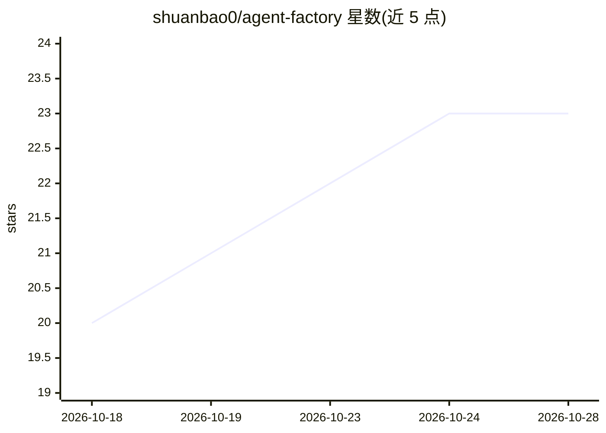

# shuanbao0/agent-factory

⭐ 23 · JavaScript · GPL-3.0 · 推送 2026-04-11 · [GitHub](https://github.com/shuanbao0/agent-factory) · [官网](https://shuanbao0.github.io/agent-factory) · 个人维护 · 中文 README

**单人驱动的自包含多智能体协作平台，内置 OpenClaw 引擎**

面向独立创作者/开发者的多智能体团队平台：以 64 个内置角色模板（CEO、PM、前后端、测试、法务、量化等）组成虚拟公司，Autopilot 模式下由 CEO agent 自动分解任务、并行执行并产出 PRD、设计、代码、测试与文案等交付物。内置 OpenClaw 引擎，无需外部运行时；支持 Anthropic、OpenAI、DeepSeek、MiniMax 等 15+ 供应商的 API key。提供 Next.js Dashboard、任务看板、N×N 权限化 agent 通信与持久记忆，经一键脚本或 npm 从源码运行。

## 筛选速览

| 维度 | 判定 | 备注 |
|---|---|---|
| AI 角色 | `ai-ecosystem` | LLM/agent 周边工具 |
| 许可风险 | `viral` | GPL-3.0 |
| 部署形态 | `library` | 以包/库形式分发 |
| 模型依赖 | locked-api |  |
| 硬件要求 | — | 无带数字的原话,不猜 |
| 安装摩擦 | `low` | 无编译、无系统依赖或容器化 |
| 成熟度 | — | 结构信号不足 |

## 能力要点

- 64 个内置 agent 角色模板，覆盖开发/商业/创意/量化团队
- Autopilot 模式：CEO agent 自动分解任务并并行执行
- 内置 OpenClaw 引擎，自包含无需外部运行时
- 多供应商 LLM 支持（Anthropic、OpenAI、DeepSeek、MiniMax 等 15+）

## 适用场景

- 独立开发者给出产品想法，由 agent 团队完成调研、PRD、开发与测试
- 创作者组建小说或动画制作流水线
- 一人公司运行市场分析、商业计划与营销文案生成
- 搭建量化研究、回测与风控的 agent 工作流

## 场景标签

`多智能体` `Agent 框架` · 领域:Agent 开发

## 证据(README 行号)

> L7:  Self-contained multi-agent collaboration platform with built-in OpenClaw engine.
> L67: - **Built-in OpenClaw Engine** — No external runtime needed, fully self-contained
> L69: - **Multi-Provider LLM Support** — Anthropic, OpenAI, DeepSeek, MiniMax, and 15+ providers

## 星数曲线

2026-10-18 20 → 2026-10-28 23（+3）

---
*卡片 v1 · prompt 1.4 · 生成 2026-10-27 · 置信度 high · 依据 README sha `8fa070bcf1d2` · [字段定义](../../DATASET.md)*
