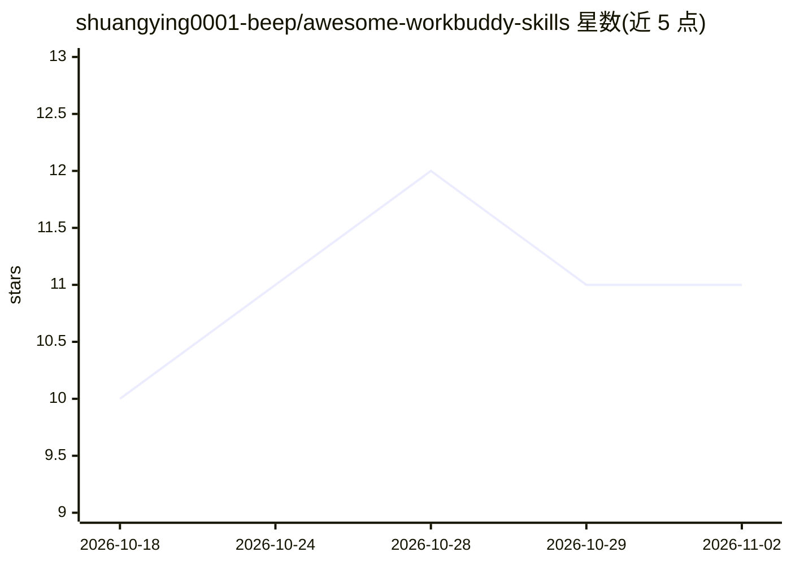

# shuangying0001-beep/awesome-workbuddy-skills

⭐ 11 · 推送 2026-07-21 · [GitHub](https://github.com/shuangying0001-beep/awesome-workbuddy-skills) · 个人维护 · 中文 README

**可直接加载的 AI Agent 技能清单：22 个实战场景技能**

围绕 WorkBuddy / Coze / 虾评实战打磨的 Agent 技能策展仓库，收录 22 个技能（公开技能仓 18 个），每个技能附 SKILL.md 可被 Agent 直接加载执行。覆盖自动化/RPA 反检测（指纹伪装、拟人化操作）、数据接入与字段映射、浏览器采集、微信生态（支付/通知/小程序）、Canvas 与 PDF 内容生成、AI 协作验收及 A2A 智能体互联等类别。使用方式为复制 SKILL.md 到 Agent 技能目录，部分技能需自行配置 Python/Node 运行时环境。

## 筛选速览

| 维度 | 判定 | 备注 |
|---|---|---|
| AI 角色 | `ai-knowledge` | 知识聚合/清单类 |
| 许可风险 | `none` | — |
| 部署形态 | `None` |  |
| 模型依赖 | — | README 未给出锁定关系 |
| 硬件要求 | — | 无带数字的原话,不猜 |
| 安装摩擦 | `low` | 无编译、无系统依赖或容器化 |
| 成熟度 | — | 结构信号不足 |

## 能力要点

- 22 个技能均附 SKILL.md，可被 Agent 直接加载执行
- 覆盖自动化/RPA 反检测、微信生态、Canvas/PDF 内容工厂等场景
- 包含 A2A 协议 0.2 的 Agent Card endpoint 技能
- 索引仓采用 MIT，各技能以仓库内 LICENSE 为准

## 适用场景

- 为 WorkBuddy 或兼容 Agent 补充爬虫防封、RPA 拟人化等自动化技能
- 接入微信支付、消息通知等微信生态能力
- 生成可打印字帖、练习纸与多页 PDF 学习资料
- 生成 AI 产出的四维度验收清单

## 场景标签

`精选清单` `网页抓取` `浏览器自动化` `工作流自动化` · 领域:效率与自动化

## 证据(README 行号)

> L3: > 一套围绕 **WorkBuddy / Coze / 虾评** 实战打磨的 AI Agent 技能集合，覆盖自动化、数据接入、浏览器采集、小程序全栈、Canvas 内容工厂、微信生态等场景。所有技能均附 `SKILL.md`，可被
> L69: 1. 复制仓库里的 `SKILL.md` 到你的 Agent skills 目录（如 `~/.workbuddy/skills/`）。

## 星数曲线

2026-10-18 10 → 2026-11-02 11（+1）

---
*卡片 v1 · prompt 1.4 · 生成 2026-11-01 · 置信度 high · 依据 README sha `c328a7244d14` · [字段定义](../../DATASET.md)*
