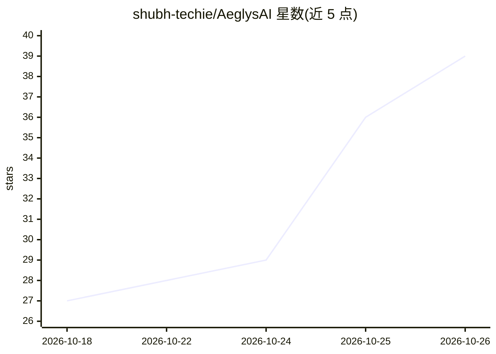

# shubh-techie/AeglysAI

⭐ 39 · Python · 推送 2026-10-13 · [GitHub](https://github.com/shubh-techie/AeglysAI) · 个人维护

**实验性自适应授权研究平台：RBAC/ABAC/风险分级决策与行为异常检测探索**

面向云原生分布式系统安全的开源研究平台（V0.1 实验阶段，前名 AegisAI）。以 .NET 8 Clean Architecture 解决方案与最小 API 提供 JWT 认证及三个实验性授权决策端点：Model A（RBAC）、Model B（RBAC+ABAC）、Model C（确定性加权上下文风险评分，README 明示该模型非 AI/ML）。行为异常检测、Model D 生产集成、强制执行与生产身份提供商接入均属 PLANNED；行为研究在独立的 ACBSD 包中基于合成数据评估。提供本地 Docker 工作流与合成数据实验运行器，声明不声称任何生产数据集或运营有效性。

## 筛选速览

| 维度 | 判定 | 备注 |
|---|---|---|
| AI 角色 | `ai-enhanced` | 去掉 AI 部分产品仍成立 |
| 许可风险 | `none` | — |
| 部署形态 | `None` |  |
| 模型依赖 | — | README 未给出锁定关系 |
| 硬件要求 | — | 无带数字的原话,不猜 |
| 安装摩擦 | `medium` | 含编译或系统依赖之一 |
| 成熟度 | `idea` | |

## 能力要点

- Model A/B/C 三个实验性授权评估端点（ALLOW/DENY/STEP_UP/LIMIT）
- 每条决策输出结构化审计事件，OpenTelemetry 兼容埋点
- 可复现的合成实验运行器与离线合成行为数据工具
- STEP_UP/LIMIT 仅为建议，无挑战/限流强制执行

## 适用场景

- 研究 RBAC/ABAC/上下文风险叠加的授权决策模型
- 探索零信任场景下的自适应授权与审计事件结构
- 基于合成数据复现 A–C 引擎对比实验

## 场景标签

`网络安全` `科研工具` · 领域:学习与行业

## 证据(README 行号)

> L14: **Under development — V0.1 experimental authorization platform.** A .NET 8 solution and minimal
> L148: This is a deterministic heuristic, not AI or ML. STEP_UP/LIMIT are recommendations
> L168: ACBSD research package adds EXPERIMENTAL synthetic

## 星数曲线

2026-10-18 27 → 2026-10-26 39（+12）

---
*卡片 v1 · prompt 1.4 · 生成 2026-10-25 · 置信度 high · 依据 README sha `9bd3431fda50` · [字段定义](../../DATASET.md)*
