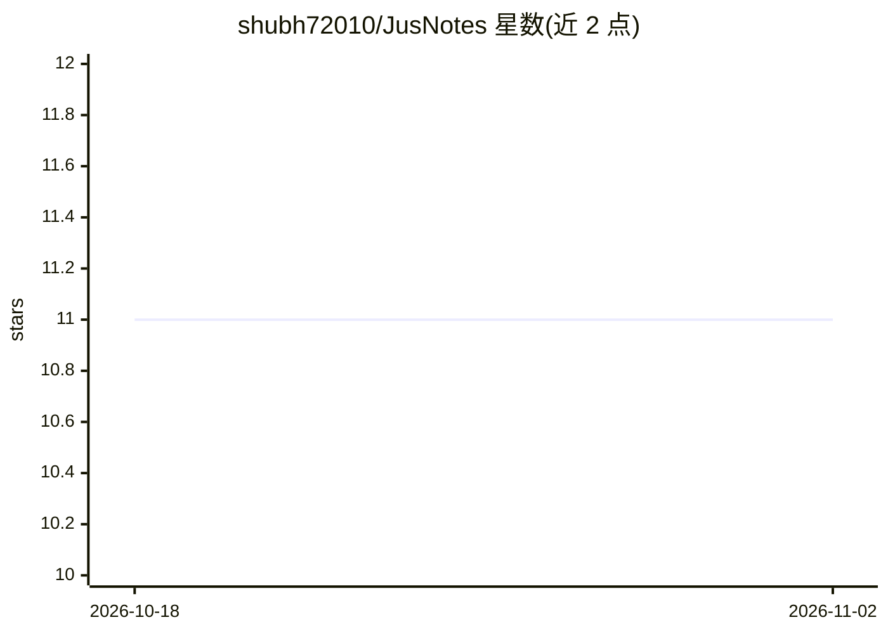

# shubh72010/JusNotes

⭐ 11 · Kotlin · GPL-3.0 · 推送 2026-09-07 · [GitHub](https://github.com/shubh72010/JusNotes) · [官网](https://github.com/shubh72010/JusNotes) · 个人维护

**Android 本地优先笔记应用，含 AI 润色与空间地图**

Kotlin + Jetpack Compose + Material 3 构建的 Android 笔记应用，采用 MVVM 与 Room 本地存储。功能包括空间地图式笔记组织、Markdown 渲染、清单、图片嵌入、生物识别加密笔记、置顶、搜索与软删除回收站。AI 能力为可选功能：通过 OpenRouter API（用户自带 key）提供润色/重写/结构化操作，密钥仅存于 DataStore，本地优先、无遥测。从源码构建需 JDK 21，另有 GitHub Releases 产物。

## 筛选速览

| 维度 | 判定 | 备注 |
|---|---|---|
| AI 角色 | `ai-enhanced` | 去掉 AI 部分产品仍成立 |
| 许可风险 | `viral` | GPL-3.0 |
| 部署形态 | `None` |  |
| 模型依赖 | locked-api |  |
| 硬件要求 | — | 无带数字的原话,不猜 |
| 安装摩擦 | `medium` | 含编译或系统依赖之一 |
| 成熟度 | — | 结构信号不足 |

## 能力要点

- 空间地图式笔记组织（拖拽画布 + [[Wiki]] 双链）
- AI 润色/重写/结构化，通过 OpenRouter 且密钥仅存本地 DataStore
- 生物识别加密笔记与 30 天自动清空回收站
- 本地优先：Room 为唯一数据源，无遥测/Firebase

## 适用场景

- 在 Android 上做带 Markdown 与清单的本地笔记
- 用空间地图和双链组织长篇笔记
- 对笔记做 AI 润色与重写且自行控制 API key

## 场景标签

`知识库管理` `AI 写作` · 领域:内容生成

## 证据(README 行号)

> L40: |🤖 **AI**|OpenRouter (`minimax/m3:free` etc, your key only). Polish / Rewrite / Structure — never stored, `DataStor
> L88: Local-first. Room (`note_database`) is the source of truth. The only network egress is an OpenRouter call when **yo

## 星数曲线

2026-10-18 11 → 2026-11-02 11（+0）

---
*卡片 v1 · prompt 1.4 · 生成 2026-11-01 · 置信度 high · 依据 README sha `254ceebadbbe` · [字段定义](../../DATASET.md)*
