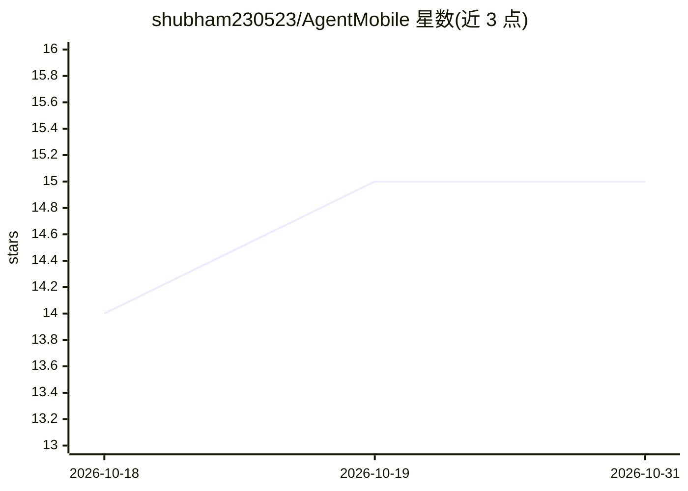

# shubham230523/AgentMobile

⭐ 15 · Kotlin · MIT · 推送 2026-03-30 · [GitHub](https://github.com/shubham230523/AgentMobile) · 个人维护

**Android 原生应用：将手机变为持续运行的 AI agent 托管平台**

Rust 核心 + Kotlin/Compose UI 的原生 Android 应用，以常驻前台服务托管自主 AI agent，可对接 30+ AI 提供商（OpenAI、Anthropic、Ollama、vLLM 等）。机制上：AES-256-GCM 加密 API 密钥并依托 Android Keystore/StrongBox，UniFFI 桥接 Rust 引擎，ZeroClaw 路由器提供 34+ FFI 函数；本地推理需连接网络内 Ollama 实例，应用本身承担编排。支持终端 REPL、Rhai 脚本与多 agent 并行，无服务器依赖，经 GitHub Releases 分发，开发者需 JDK 17+/NDK/Rust 从源码构建。

## 筛选速览

| 维度 | 判定 | 备注 |
|---|---|---|
| AI 角色 | `ai-ecosystem` | LLM/agent 周边工具 |
| 许可风险 | `permissive` | MIT |
| 部署形态 | `None` |  |
| 模型依赖 | local-ok | 支持本地模型 |
| 硬件要求 | — | 无带数字的原话,不猜 |
| 安装摩擦 | `low` | 无编译、无系统依赖或容器化 |
| 成熟度 | — | 结构信号不足 |

## 能力要点

- 常驻前台服务托管 agent，日均待机耗电 2-5%
- 30+ 提供商接入，含 Ollama/vLLM/LM Studio 等本地后端
- AES-256-GCM 加密密钥存储 + 硬件 Keystore/StrongBox 与生物识别
- 终端 REPL 与 Rhai 脚本引擎支持自动化与定时任务

## 适用场景

- 把闲置 Android 手机作为 7x24 小时 AI agent 运行主机
- 在不搭服务器的前提下运行多个不同提供商/模型的 agent
- 通过终端 REPL 或脚本编排 agent 的定时任务与用量监控

## 场景标签

`多智能体` `Agent 框架` · 领域:Agent 开发

## 证据(README 行号)

> L12: AgentMobile is a native Android application that transforms your smartphone into a continuously running AI agent pl
> L19: - **Universal Compatibility**: Support for OpenAI, Claude, Gemini, Ollama, and 25+ more providers
> L202: AgentMobile acts as an intelligent router. For local inference, connect to an Ollama instance running on your netw

## 星数曲线

2026-10-18 14 → 2026-10-31 15（+1）

---
*卡片 v1 · prompt 1.4 · 生成 2026-10-30 · 置信度 high · 依据 README sha `81a31511f9c4` · [字段定义](../../DATASET.md)*
