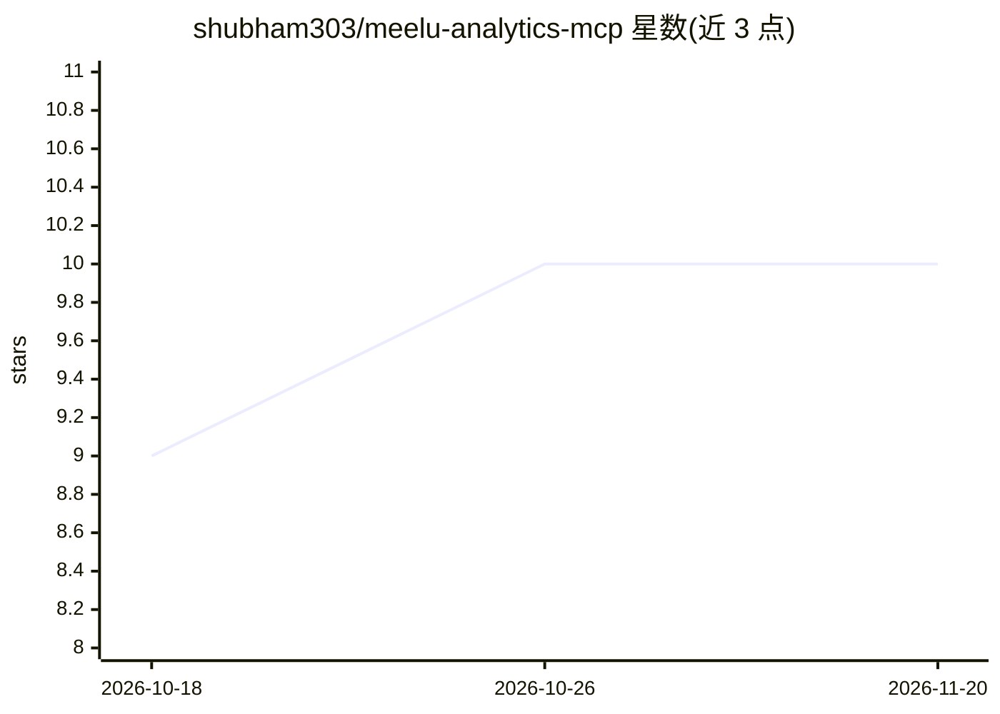

# shubham303/meelu-analytics-mcp

⭐ 10 · Python · MIT · 推送 2026-10-19 · [GitHub](https://github.com/shubham303/meelu-analytics-mcp) · 个人维护

**给 AI 助手接入 47 个自动选法的统计分析 MCP 工具**

一个面向 AI 助手的 MCP 服务器，内置 47 个统计分析工具：用户用自然语言提问，引擎根据数据自动选择统计方法、运行分析并给出可信度评级，数据无法回答时直接拒答而非编造。覆盖描述统计、关联检验、聚类、预测、时间序列、因果推断与客户分析（RFM/购物篮/同期群）。通过一条 curl 安装脚本接入 Claude Code、Claude Desktop、Cursor 等 10 种客户端，基于 DuckDB、scikit-learn、statsmodels、SHAP 和 DoWhy 构建，完全本地运行；可选 TabICL 表格基础模型提升预测精度。安装器目前只在 macOS 和 Linux 上测试过。

## 筛选速览

| 维度 | 判定 | 备注 |
|---|---|---|
| AI 角色 | `ai-ecosystem` | LLM/agent 周边工具 |
| 许可风险 | `permissive` | MIT |
| 部署形态 | `None` |  |
| 模型依赖 | locked-api |  |
| 硬件要求 | — | 无带数字的原话,不猜 |
| 安装摩擦 | `low` | 无编译、无系统依赖或容器化 |
| 成熟度 | — | 结构信号不足 |

## 能力要点

- 47 个统计工具，方法由数据自动选择并记录选法依据
- 每个结果带可信度评级，无法回答时明确拒答
- 一条 curl 脚本自动配置 10 种 MCP 客户端，改动前备份原配置
- 基于 DuckDB/scikit-learn/statsmodels/SHAP/DoWhy，完全本地运行

## 适用场景

- 用自然语言问 CSV 数据里哪个客户层级真正驱动收入
- 让助手做带可信度说明的流失预测与客户分群
- 判断两个变量的关系是因果还是相关
- 把会话中的分群、预测结果持久化，后续问题接着做

## 场景标签

`数据分析` · 领域:效率与自动化

## 证据(README 行号)

> L18: This tool sits between your assistant and your data and takes those judgement
> L36: There are 47 tools under the hood, but you never call them. You ask; your
> L134:     "meelu-analytics": {

## 星数曲线

2026-10-18 9 → 2026-11-20 10（+1）

---
*卡片 v1 · prompt 1.4 · 生成 2026-11-19 · 置信度 high · 依据 README sha `721696d71c91` · [字段定义](../../DATASET.md)*
