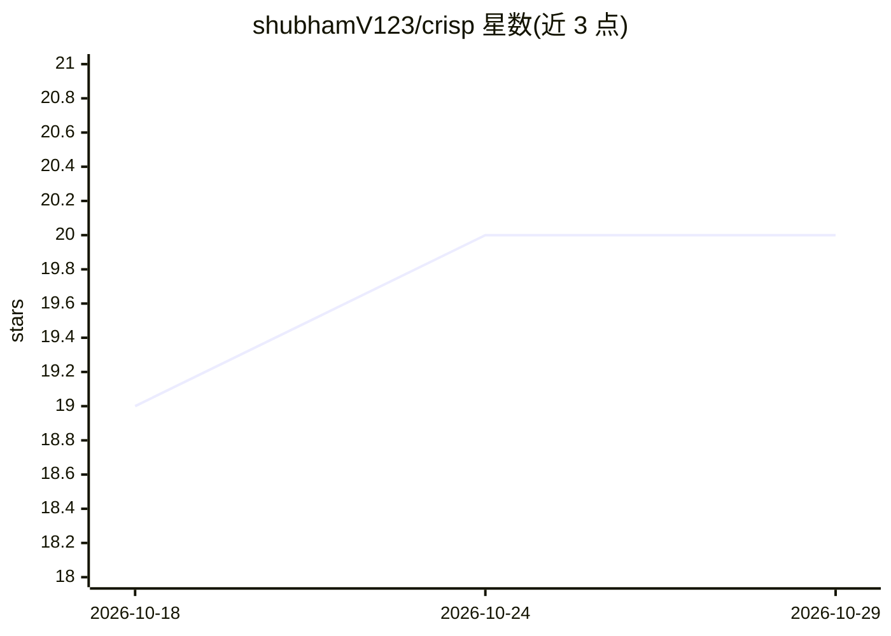

# shubhamV123/crisp

⭐ 20 · Shell · MIT · 推送 2026-05-21 · [GitHub](https://github.com/shubhamV123/crisp) · 个人维护

**AI agent 的简洁输出技能：减少回复冗词但保留技术细节**

遵循 Agent Skills 规范的 terse-output 技能，通过 SKILL.md 指令让 agent 去除开场白、填充词与重复上下文，同时保留代码块、错误信息、命令、数字与安全警告原文。对破坏性操作、安全警告与多步骤场景自动切换清晰完整表述，之后恢复简洁模式。README 给出 Claude 各模型输出 token 缩减基准（最高约 70%），并声明仅改变回复风格、不改变模型正确性。安装用 npx skills add，或将 SKILL.md 粘贴进对话。

## 筛选速览

| 维度 | 判定 | 备注 |
|---|---|---|
| AI 角色 | `ai-ecosystem` | LLM/agent 周边工具 |
| 许可风险 | `permissive` | MIT |
| 部署形态 | `library` | 以包/库形式分发 |
| 模型依赖 | — | README 未给出锁定关系 |
| 硬件要求 | — | 无带数字的原话,不猜 |
| 安装摩擦 | `low` | 无编译、无系统依赖或容器化 |
| 成熟度 | — | 结构信号不足 |

## 能力要点

- 去除填充词但代码/错误信息/命令/数字保持原文
- 破坏性操作与安全警告自动切换为完整清晰表述
- 一次激活持续整个对话，支持多种触发短语
- 附 Claude API 输出 token 缩减基准（最高约 70%）

## 适用场景

- 让编码 agent 的回复更短更快阅读
- 减少长对话中的输出 token 消耗
- 在保留安全警告清晰度的前提下压缩日常回复

## 场景标签

`提示工程` · 领域:Agent 开发

## 证据(README 行号)

> L3: A terse-output skill for AI agents. Shorter replies without stripping technical details.
> L50: crisp follows the Agent Skills specification. It works with any agent that supports skills.

## 星数曲线

2026-10-18 19 → 2026-10-29 20（+1）

---
*卡片 v1 · prompt 1.4 · 生成 2026-10-28 · 置信度 high · 依据 README sha `a31d6710bdf7` · [字段定义](../../DATASET.md)*
