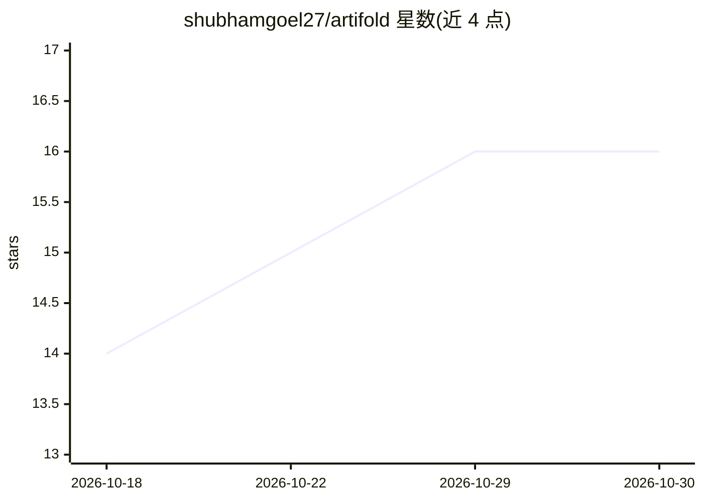

# shubhamgoel27/artifold

⭐ 16 · Python · MIT · 推送 2026-10-29 · [GitHub](https://github.com/shubhamgoel27/artifold) · [官网](https://github.com/shubhamgoel27/artifold) · 个人维护

**给 Claude Code/Codex 的页面设计技能与本地 HTML 产物库**

由个人维护的两部分组成：craft 技能安装到 Claude Code（/craft）或 Codex（$craft），按主题选择布局、字体与视觉风格，检查 15 种 AI 设计习惯并在无头浏览器中渲染验证；库部分为本地仪表盘，索引指定文件夹内所有 HTML 文件（无论由何工具生成），提供缩略图、搜索、版本历史与 diff、一键发布到用户自己的 GitHub Pages。索引与搜索离线运行，AI 描述为可选项（Anthropic API）。版本 0.14 alpha，Windows 未测试。

## 筛选速览

| 维度 | 判定 | 备注 |
|---|---|---|
| AI 角色 | `ai-ecosystem` | LLM/agent 周边工具 |
| 许可风险 | `permissive` | MIT |
| 部署形态 | `library` | 以包/库形式分发 |
| 模型依赖 | — | README 未给出锁定关系 |
| 硬件要求 | — | 无带数字的原话,不猜 |
| 安装摩擦 | `low` | 无编译、无系统依赖或容器化 |
| 成熟度 | `idea` | |

## 能力要点

- craft 技能按主题定制布局与设计并在桌面/手机宽度下渲染验证
- 本地库索引任意来源的 HTML，提供搜索（⌘K）、版本合并与 diff
- 一键分享到用户自己的 GitHub Pages，需 gh CLI
- 索引与搜索离线运行，无托管服务与账号

## 适用场景

- 让 Claude Code/Codex 生成的页面按主题定制设计而非千篇一律
- 集中管理散落各处的 AI 生成 HTML 页面并检索复用
- 把某个页面快速发布成公开链接分享给他人

## 场景标签

 · 领域:开发者工具/AI 产物管理

## 证据(README 行号)

> L19: Works with Claude Code and Codex.
> L46: Type `/craft a 30-day strength tracker for a beginner` in Claude Code, or
> L123: The library indexes any HTML, whatever wrote it: Claude, ChatGPT Canvas,

## 星数曲线

2026-10-18 14 → 2026-10-30 16（+2）

---
*卡片 v1 · prompt 1.4 · 生成 2026-10-30 · 置信度 high · 依据 README sha `805bcdb68d8c` · [字段定义](../../DATASET.md)*
